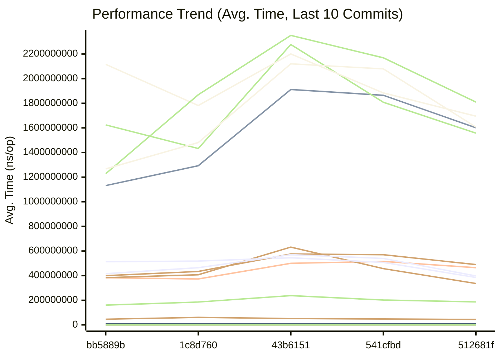
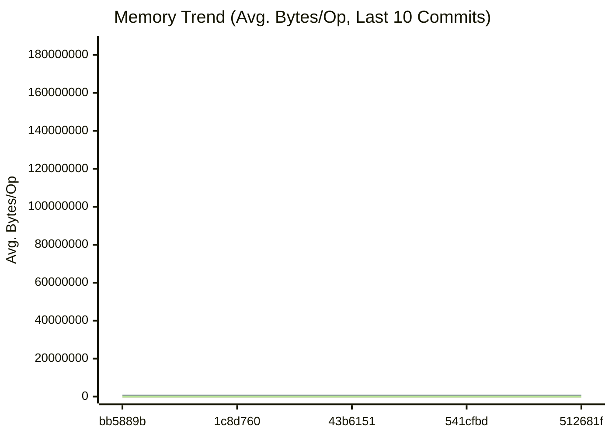
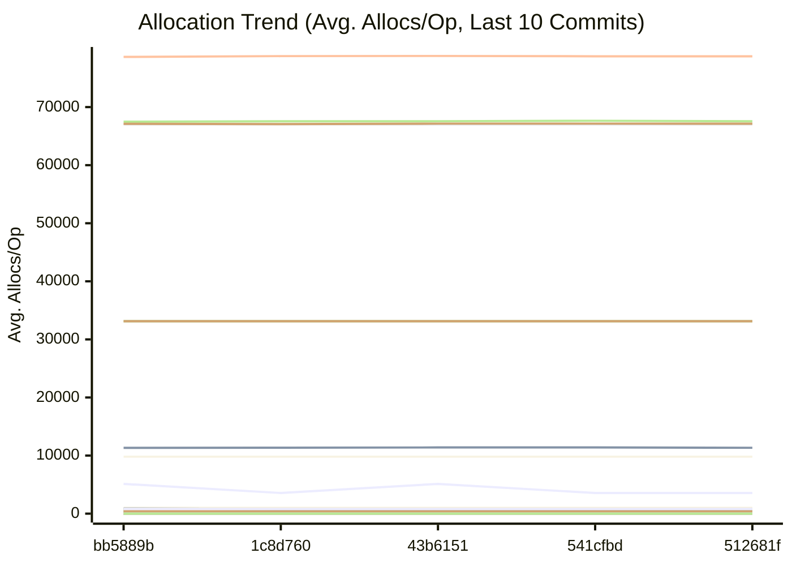

# Performance Benchmarks

This document tracks benchmark performance across commits. The section between
the `BENCHMARK_RESULTS_START/END` markers is auto-generated by the pre-commit
hook; the crypto/OPRF section below is manually maintained.

## How to Read This Document

- **Comparison with previous commit**: `benchstat` output comparing the current
  commit against the previous one. Three tables: **sec/op** (time per operation),
  **B/op** (bytes allocated), **allocs/op** (heap allocations). In each table,
  **lower is better**. `+X%` = regression, `-X%` = improvement, `~` = no
  statistically significant change. `p` is the p-value (p < 0.05 = significant).
- **Latest Benchmark Results**: Single-snapshot table of the current commit's
  averages. Lower values are better across all three columns.
- **Performance Trend plot**: X-axis = commit SHA (left = older, right = newer).
  Y-axis = avg time in ns/op. **Lower lines = faster.** Downward trends are
  improvements; upward spikes are regressions.
- **Memory Trend plot**: Same axes, but Y-axis = avg bytes allocated per op.
  **Lower lines = less memory.** Drops indicate allocation reductions.
- **Allocation Trend plot**: Same axes, but Y-axis = avg heap allocations per op.
  **Lower lines = fewer allocations.** Fewer allocs = less GC pressure.

## Feature Hot-Path Benchmarks

Measured with `go test -bench` on the packages that own the code; each number is
a snapshot, not a CI gate. Run the listed command to reproduce on your hardware.

| Benchmark | Command | Result | Notes |
|---|---|---|---|
| `BenchmarkParseChecksum` | `go test ./src/transport -bench BenchmarkParseChecksum` | ~450 ns/op, **0 B/op, 0 allocs/op** | S3 checksum-header probe after the pre-canonicalized table (#1275). The dynamic baseline (`BenchmarkParseChecksumDynamicBaseline`) is ~930 ns/op, 96 B/op, 4 allocs/op. |
| `BenchmarkEtagMatches` | `go test ./src/transport -bench BenchmarkEtagMatches` | ~127 ns/op, **0 allocs/op** | Conditional request tag scan; `strings.Split` baseline is ~257 ns/op, 80 B/op, 1 alloc. |
| `BenchmarkParseAWSChunkHeader` | `go test ./src/transport -bench BenchmarkParseAWSChunkHeader` | ~60 ns/op, **0 allocs/op** | aws-chunked framing on S3 ingest; `strings.Split` baseline allocates 32 B/op per chunk. |
| `BenchmarkRebalanceCycle` | `go test ./src/server -bench BenchmarkRebalanceCycle` | **~25 ms per pass @ 1000 blobs** | Statfs + blob walk + coldness sort + placement. Linear in blob count; a tick every 300 s is comfortable, a million-blob node pays ~25 s per pass and only above the high-water mark. |
| `BenchmarkWriteThrottled` | `go test ./src/server -bench BenchmarkWriteThrottled` | **~1.2 µs per MiB @ 10 Gbps** | The bandwidth limiter is not the bottleneck above the cap. |
| `BenchmarkTrustedRead` | `go test ./src/storage -bench BenchmarkTrustedRead` | constant **11 allocs/op** | Read-verifier seam: re-verifying a trusted blob is disk-bound, not allocation-bound. |
| `BenchmarkParseCPUStat` | `go test ./src/p2p -bench BenchmarkParseCPUStat` | ~484 ns/op, **0 B/op, 0 allocs/op** | Health monitor `/proc/stat` parsing (#1311). The `strings.Split` baseline (`BenchmarkParseCPUStatSplitBaseline`) is ~1324 ns/op, 1840 B/op, 5 allocs/op. |
| `BenchmarkParseMemPercent` | `go test ./src/p2p -bench BenchmarkParseMemPercent` | ~749 ns/op, **0 B/op, 0 allocs/op** | Health monitor `/proc/meminfo` parsing (#1311). The baseline is ~3299 ns/op, 1888 B/op, 24 allocs/op; the sampler runs every 10 s, so this is garbage removal rather than a hot-path win. |

<!-- BENCHMARK_RESULTS_START -->
## Performance

This section is automatically updated by the pre-commit hook (via .github/scripts/update_readme_with_benchmarks.sh).

### Comparison with previous commit

Each table compares the previous commit (left) to the current commit (right).
**Lower is better** in all three tables. `+X%` = regression, `-X%` = improvement,
`~` = no statistically significant change (p >= 0.05).

- **sec/op**: Time per operation (nanoseconds). Measures raw speed.
- **B/op**: Bytes allocated on the heap per operation. Measures memory usage.
- **allocs/op**: Number of heap allocations per operation. Measures GC pressure.

```
                                      │ /tmp/old_bench_filtered.txt │      /tmp/new_bench_filtered.txt      │
                                      │           sec/op            │    sec/op      vs base                │
CrushOriginal-8                                        495.6n ± ∞ ¹    496.5n ± ∞ ¹       ~ (p=1.000 n=1) ²
Placement-8                                            6.056µ ± ∞ ¹    5.033µ ± ∞ ¹       ~ (p=1.000 n=1) ²
PlacementDomainSpread-8                                5.795µ ± ∞ ¹    5.475µ ± ∞ ¹       ~ (p=1.000 n=1) ²
CrushOptimized-8                                       399.9n ± ∞ ¹    336.5n ± ∞ ¹       ~ (p=1.000 n=1) ²
LoadGlobalConfig-8                                    10.909µ ± ∞ ¹    9.544µ ± ∞ ¹       ~ (p=1.000 n=1) ²
HashBytes/1MiB-8                                       4.375m ± ∞ ¹    4.746m ± ∞ ¹       ~ (p=1.000 n=1) ²
HashBytes/64MiB-8                                      286.0m ± ∞ ¹    217.0m ± ∞ ¹       ~ (p=1.000 n=1) ²
HashBytes/256MiB-8                                    1025.0m ± ∞ ¹    970.0m ± ∞ ¹       ~ (p=1.000 n=1) ²
HashFile/1MiB-8                                        4.916m ± ∞ ¹    3.947m ± ∞ ¹       ~ (p=1.000 n=1) ²
HashFile/64MiB-8                                       266.5m ± ∞ ¹    247.1m ± ∞ ¹       ~ (p=1.000 n=1) ²
HashFile/256MiB-8                                      791.0m ± ∞ ¹   1027.0m ± ∞ ¹       ~ (p=1.000 n=1) ²
PadString-8                                            45.68n ± ∞ ¹    47.98n ± ∞ ¹       ~ (p=1.000 n=1) ²
SanitizeLog/Safe-8                                     265.7n ± ∞ ¹    300.6n ± ∞ ¹       ~ (p=1.000 n=1) ²
SanitizeLog/Unsafe-8                                   739.3n ± ∞ ¹    756.8n ± ∞ ¹       ~ (p=1.000 n=1) ²
AWSChunkedReaderSigned-8                               498.7µ ± ∞ ¹    442.8µ ± ∞ ¹       ~ (p=1.000 n=1) ²
AWSChunkedReaderUnsigned-8                             451.4µ ± ∞ ¹    492.1µ ± ∞ ¹       ~ (p=1.000 n=1) ²
ParseAWSChunkHeader-8                                  50.70n ± ∞ ¹    51.59n ± ∞ ¹       ~ (p=1.000 n=1) ²
ParseChecksum-8                                        421.6n ± ∞ ¹    455.7n ± ∞ ¹       ~ (p=1.000 n=1) ²
ParseChecksumDynamicBaseline-8                         1.068µ ± ∞ ¹    1.121µ ± ∞ ¹       ~ (p=1.000 n=1) ²
LastModifiedHeader_AppendFormat-8                      237.0n ± ∞ ¹    238.0n ± ∞ ¹       ~ (p=1.000 n=1) ²
LastModifiedHeader_Format-8                            300.2n ± ∞ ¹    268.1n ± ∞ ¹       ~ (p=1.000 n=1) ²
EtagMatches-8                                          139.5n ± ∞ ¹    162.6n ± ∞ ¹       ~ (p=1.000 n=1) ²
EtagMatchesSplit-8                                     241.7n ± ∞ ¹    235.9n ± ∞ ¹       ~ (p=1.000 n=1) ²
ListPartsTime_AppendFormat-8                           128.1n ± ∞ ¹    140.2n ± ∞ ¹       ~ (p=1.000 n=1) ²
ListPartsTime_Format-8                                 179.3n ± ∞ ¹    163.9n ± ∞ ¹       ~ (p=1.000 n=1) ²
FormatListObjectsV2XML_AppendFormat-8                  756.4µ ± ∞ ¹    554.4µ ± ∞ ¹       ~ (p=1.000 n=1) ²
FormatListObjectsV2XML_OldFormat-8                     415.5µ ± ∞ ¹    375.6µ ± ∞ ¹       ~ (p=1.000 n=1) ²
PheromoneSelectReplica-8                               142.5n ± ∞ ¹    138.0n ± ∞ ¹       ~ (p=1.000 n=1) ²
CheckMetricsAndSwap-8                                  9.526n ± ∞ ¹    9.899n ± ∞ ¹       ~ (p=1.000 n=1) ²
IndexSearch-8                                          2.908n ± ∞ ¹    3.219n ± ∞ ¹       ~ (p=1.000 n=1) ²
IndexDirectTracking-8                                 0.3580n ± ∞ ¹   0.3615n ± ∞ ¹       ~ (p=1.000 n=1) ²
PickShedTarget-8                                       1.816µ ± ∞ ¹    1.720µ ± ∞ ¹       ~ (p=1.000 n=1) ²
WriteThrottled/unlimited-8                             5.932n ± ∞ ¹    5.633n ± ∞ ¹       ~ (p=1.000 n=1) ²
WriteThrottled/throttled-10Gbps-8                      738.9µ ± ∞ ¹    738.9µ ± ∞ ¹       ~ (p=1.000 n=1) ²
LocalWrite/1MiB-8                                      526.4µ ± ∞ ¹    459.3µ ± ∞ ¹       ~ (p=1.000 n=1) ²
LocalWrite/64MiB-8                                     27.70m ± ∞ ¹    26.06m ± ∞ ¹       ~ (p=1.000 n=1) ²
LocalWrite/256MiB-8                                    120.4m ± ∞ ¹    107.9m ± ∞ ¹       ~ (p=1.000 n=1) ²
ReadVerify/1MiB-8                                      3.486m ± ∞ ¹    4.318m ± ∞ ¹       ~ (p=1.000 n=1) ²
ReadVerify/64MiB-8                                     261.1m ± ∞ ¹    297.3m ± ∞ ¹       ~ (p=1.000 n=1) ²
ReadVerify/256MiB-8                                   1073.2m ± ∞ ¹    969.8m ± ∞ ¹       ~ (p=1.000 n=1) ²
TrustedRead/1MiB-8                                     5.041m ± ∞ ¹    4.592m ± ∞ ¹       ~ (p=1.000 n=1) ²
TrustedRead/64MiB-8                                    278.6m ± ∞ ¹    268.2m ± ∞ ¹       ~ (p=1.000 n=1) ²
TrustedRead/256MiB-8                                   989.2m ± ∞ ¹   1043.7m ± ∞ ¹       ~ (p=1.000 n=1) ²
S3PutSpool/1MiB-8                                      3.882m ± ∞ ¹    3.964m ± ∞ ¹       ~ (p=1.000 n=1) ²
S3PutSpool/64MiB-8                                     273.7m ± ∞ ¹    336.2m ± ∞ ¹       ~ (p=1.000 n=1) ²
S3PutSpool/256MiB-8                                     1.186 ± ∞ ¹     1.064 ± ∞ ¹       ~ (p=1.000 n=1) ²
ParseACLResource_Split-8                               15.01n ± ∞ ¹    12.97n ± ∞ ¹       ~ (p=1.000 n=1) ²
ParseACLResource_IndexByte-8                           15.18n ± ∞ ¹    13.40n ± ∞ ¹       ~ (p=1.000 n=1) ²
geomean                                                48.21µ          47.03µ        -2.47%
¹ need >= 6 samples for confidence interval at level 0.95
² need >= 4 samples to detect a difference at alpha level 0.05

                                      │ /tmp/old_bench_filtered.txt │      /tmp/new_bench_filtered.txt      │
                                      │            B/op             │     B/op       vs base                │
CrushOriginal-8                                         164.0 ± ∞ ¹     164.0 ± ∞ ¹       ~ (p=1.000 n=1) ²
Placement-8                                             352.0 ± ∞ ¹     352.0 ± ∞ ¹       ~ (p=1.000 n=1) ²
PlacementDomainSpread-8                                 352.0 ± ∞ ¹     352.0 ± ∞ ¹       ~ (p=1.000 n=1) ²
CrushOptimized-8                                        0.000 ± ∞ ¹     0.000 ± ∞ ¹       ~ (p=1.000 n=1) ²
LoadGlobalConfig-8                                    1.930Ki ± ∞ ¹   1.930Ki ± ∞ ¹       ~ (p=1.000 n=1) ²
HashBytes/1MiB-8                                        64.00 ± ∞ ¹     64.00 ± ∞ ¹       ~ (p=1.000 n=1) ²
HashBytes/64MiB-8                                       64.00 ± ∞ ¹     64.00 ± ∞ ¹       ~ (p=1.000 n=1) ²
HashBytes/256MiB-8                                      64.00 ± ∞ ¹     64.00 ± ∞ ¹       ~ (p=1.000 n=1) ²
HashFile/1MiB-8                                       32.35Ki ± ∞ ¹   32.35Ki ± ∞ ¹       ~ (p=1.000 n=1) ²
HashFile/64MiB-8                                      32.35Ki ± ∞ ¹   32.35Ki ± ∞ ¹       ~ (p=1.000 n=1) ²
HashFile/256MiB-8                                     32.35Ki ± ∞ ¹   32.35Ki ± ∞ ¹       ~ (p=1.000 n=1) ²
PadString-8                                             64.00 ± ∞ ¹     64.00 ± ∞ ¹       ~ (p=1.000 n=1) ²
SanitizeLog/Safe-8                                      0.000 ± ∞ ¹     0.000 ± ∞ ¹       ~ (p=1.000 n=1) ²
SanitizeLog/Unsafe-8                                    704.0 ± ∞ ¹     704.0 ± ∞ ¹       ~ (p=1.000 n=1) ²
AWSChunkedReaderSigned-8                              10.92Ki ± ∞ ¹   10.92Ki ± ∞ ¹       ~ (p=1.000 n=1) ³
AWSChunkedReaderUnsigned-8                            76.69Ki ± ∞ ¹   76.69Ki ± ∞ ¹       ~ (p=1.000 n=1) ³
ParseAWSChunkHeader-8                                   0.000 ± ∞ ¹     0.000 ± ∞ ¹       ~ (p=1.000 n=1) ²
ParseChecksum-8                                         0.000 ± ∞ ¹     0.000 ± ∞ ¹       ~ (p=1.000 n=1) ²
ParseChecksumDynamicBaseline-8                          96.00 ± ∞ ¹     96.00 ± ∞ ¹       ~ (p=1.000 n=1) ²
LastModifiedHeader_AppendFormat-8                       0.000 ± ∞ ¹     0.000 ± ∞ ¹       ~ (p=1.000 n=1) ²
LastModifiedHeader_Format-8                             32.00 ± ∞ ¹     32.00 ± ∞ ¹       ~ (p=1.000 n=1) ²
EtagMatches-8                                           0.000 ± ∞ ¹     0.000 ± ∞ ¹       ~ (p=1.000 n=1) ²
EtagMatchesSplit-8                                      80.00 ± ∞ ¹     80.00 ± ∞ ¹       ~ (p=1.000 n=1) ²
ListPartsTime_AppendFormat-8                            0.000 ± ∞ ¹     0.000 ± ∞ ¹       ~ (p=1.000 n=1) ²
ListPartsTime_Format-8                                  24.00 ± ∞ ¹     24.00 ± ∞ ¹       ~ (p=1.000 n=1) ²
FormatListObjectsV2XML_AppendFormat-8                 512.1Ki ± ∞ ¹   512.1Ki ± ∞ ¹       ~ (p=1.000 n=1) ³
FormatListObjectsV2XML_OldFormat-8                    23.44Ki ± ∞ ¹   23.44Ki ± ∞ ¹       ~ (p=1.000 n=1) ²
PheromoneSelectReplica-8                                0.000 ± ∞ ¹     0.000 ± ∞ ¹       ~ (p=1.000 n=1) ²
CheckMetricsAndSwap-8                                   0.000 ± ∞ ¹     0.000 ± ∞ ¹       ~ (p=1.000 n=1) ²
IndexSearch-8                                           0.000 ± ∞ ¹     0.000 ± ∞ ¹       ~ (p=1.000 n=1) ²
IndexDirectTracking-8                                   0.000 ± ∞ ¹     0.000 ± ∞ ¹       ~ (p=1.000 n=1) ²
PickShedTarget-8                                        176.0 ± ∞ ¹     176.0 ± ∞ ¹       ~ (p=1.000 n=1) ²
WriteThrottled/unlimited-8                              0.000 ± ∞ ¹     0.000 ± ∞ ¹       ~ (p=1.000 n=1) ²
WriteThrottled/throttled-10Gbps-8                       298.0 ± ∞ ¹     318.0 ± ∞ ¹       ~ (p=1.000 n=1) ³
LocalWrite/1MiB-8                                     65.50Ki ± ∞ ¹   65.50Ki ± ∞ ¹       ~ (p=1.000 n=1) ²
LocalWrite/64MiB-8                                    65.55Ki ± ∞ ¹   65.54Ki ± ∞ ¹       ~ (p=1.000 n=1) ³
LocalWrite/256MiB-8                                   65.76Ki ± ∞ ¹   65.76Ki ± ∞ ¹       ~ (p=1.000 n=1) ²
ReadVerify/1MiB-8                                       435.0 ± ∞ ¹     469.0 ± ∞ ¹       ~ (p=1.000 n=1) ³
ReadVerify/64MiB-8                                    2.711Ki ± ∞ ¹   2.711Ki ± ∞ ¹       ~ (p=1.000 n=1) ²
ReadVerify/256MiB-8                                   9.578Ki ± ∞ ¹   5.000Ki ± ∞ ¹       ~ (p=1.000 n=1) ³
TrustedRead/1MiB-8                                      800.0 ± ∞ ¹     800.0 ± ∞ ¹       ~ (p=1.000 n=1) ²
TrustedRead/64MiB-8                                     800.0 ± ∞ ¹     800.0 ± ∞ ¹       ~ (p=1.000 n=1) ²
TrustedRead/256MiB-8                                    800.0 ± ∞ ¹     800.0 ± ∞ ¹       ~ (p=1.000 n=1) ²
S3PutSpool/1MiB-8                                       447.0 ± ∞ ¹     447.0 ± ∞ ¹       ~ (p=1.000 n=1) ²
S3PutSpool/64MiB-8                                      448.0 ± ∞ ¹     448.0 ± ∞ ¹       ~ (p=1.000 n=1) ²
S3PutSpool/256MiB-8                                     448.0 ± ∞ ¹     448.0 ± ∞ ¹       ~ (p=1.000 n=1) ²
ParseACLResource_Split-8                                0.000 ± ∞ ¹     0.000 ± ∞ ¹       ~ (p=1.000 n=1) ²
ParseACLResource_IndexByte-8                            0.000 ± ∞ ¹     0.000 ± ∞ ¹       ~ (p=1.000 n=1) ²
geomean                                                           ⁴                  -1.06%               ⁴
¹ need >= 6 samples for confidence interval at level 0.95
² all samples are equal
³ need >= 4 samples to detect a difference at alpha level 0.05
⁴ summaries must be >0 to compute geomean

                                      │ /tmp/old_bench_filtered.txt │     /tmp/new_bench_filtered.txt      │
                                      │          allocs/op          │  allocs/op    vs base                │
CrushOriginal-8                                         3.000 ± ∞ ¹    3.000 ± ∞ ¹       ~ (p=1.000 n=1) ²
Placement-8                                             6.000 ± ∞ ¹    6.000 ± ∞ ¹       ~ (p=1.000 n=1) ²
PlacementDomainSpread-8                                 6.000 ± ∞ ¹    6.000 ± ∞ ¹       ~ (p=1.000 n=1) ²
CrushOptimized-8                                        0.000 ± ∞ ¹    0.000 ± ∞ ¹       ~ (p=1.000 n=1) ²
LoadGlobalConfig-8                                      58.00 ± ∞ ¹    58.00 ± ∞ ¹       ~ (p=1.000 n=1) ²
HashBytes/1MiB-8                                        1.000 ± ∞ ¹    1.000 ± ∞ ¹       ~ (p=1.000 n=1) ²
HashBytes/64MiB-8                                       1.000 ± ∞ ¹    1.000 ± ∞ ¹       ~ (p=1.000 n=1) ²
HashBytes/256MiB-8                                      1.000 ± ∞ ¹    1.000 ± ∞ ¹       ~ (p=1.000 n=1) ²
HashFile/1MiB-8                                         6.000 ± ∞ ¹    6.000 ± ∞ ¹       ~ (p=1.000 n=1) ²
HashFile/64MiB-8                                        6.000 ± ∞ ¹    6.000 ± ∞ ¹       ~ (p=1.000 n=1) ²
HashFile/256MiB-8                                       6.000 ± ∞ ¹    6.000 ± ∞ ¹       ~ (p=1.000 n=1) ²
PadString-8                                             1.000 ± ∞ ¹    1.000 ± ∞ ¹       ~ (p=1.000 n=1) ²
SanitizeLog/Safe-8                                      0.000 ± ∞ ¹    0.000 ± ∞ ¹       ~ (p=1.000 n=1) ²
SanitizeLog/Unsafe-8                                    1.000 ± ∞ ¹    1.000 ± ∞ ¹       ~ (p=1.000 n=1) ²
AWSChunkedReaderSigned-8                                77.00 ± ∞ ¹    77.00 ± ∞ ¹       ~ (p=1.000 n=1) ²
AWSChunkedReaderUnsigned-8                              12.00 ± ∞ ¹    12.00 ± ∞ ¹       ~ (p=1.000 n=1) ²
ParseAWSChunkHeader-8                                   0.000 ± ∞ ¹    0.000 ± ∞ ¹       ~ (p=1.000 n=1) ²
ParseChecksum-8                                         0.000 ± ∞ ¹    0.000 ± ∞ ¹       ~ (p=1.000 n=1) ²
ParseChecksumDynamicBaseline-8                          4.000 ± ∞ ¹    4.000 ± ∞ ¹       ~ (p=1.000 n=1) ²
LastModifiedHeader_AppendFormat-8                       0.000 ± ∞ ¹    0.000 ± ∞ ¹       ~ (p=1.000 n=1) ²
LastModifiedHeader_Format-8                             1.000 ± ∞ ¹    1.000 ± ∞ ¹       ~ (p=1.000 n=1) ²
EtagMatches-8                                           0.000 ± ∞ ¹    0.000 ± ∞ ¹       ~ (p=1.000 n=1) ²
EtagMatchesSplit-8                                      1.000 ± ∞ ¹    1.000 ± ∞ ¹       ~ (p=1.000 n=1) ²
ListPartsTime_AppendFormat-8                            0.000 ± ∞ ¹    0.000 ± ∞ ¹       ~ (p=1.000 n=1) ²
ListPartsTime_Format-8                                  1.000 ± ∞ ¹    1.000 ± ∞ ¹       ~ (p=1.000 n=1) ²
FormatListObjectsV2XML_AppendFormat-8                   16.00 ± ∞ ¹    16.00 ± ∞ ¹       ~ (p=1.000 n=1) ²
FormatListObjectsV2XML_OldFormat-8                     1.000k ± ∞ ¹   1.000k ± ∞ ¹       ~ (p=1.000 n=1) ²
PheromoneSelectReplica-8                                0.000 ± ∞ ¹    0.000 ± ∞ ¹       ~ (p=1.000 n=1) ²
CheckMetricsAndSwap-8                                   0.000 ± ∞ ¹    0.000 ± ∞ ¹       ~ (p=1.000 n=1) ²
IndexSearch-8                                           0.000 ± ∞ ¹    0.000 ± ∞ ¹       ~ (p=1.000 n=1) ²
IndexDirectTracking-8                                   0.000 ± ∞ ¹    0.000 ± ∞ ¹       ~ (p=1.000 n=1) ²
PickShedTarget-8                                        6.000 ± ∞ ¹    6.000 ± ∞ ¹       ~ (p=1.000 n=1) ²
WriteThrottled/unlimited-8                              0.000 ± ∞ ¹    0.000 ± ∞ ¹       ~ (p=1.000 n=1) ²
WriteThrottled/throttled-10Gbps-8                       3.000 ± ∞ ¹    3.000 ± ∞ ¹       ~ (p=1.000 n=1) ²
LocalWrite/1MiB-8                                       19.00 ± ∞ ¹    20.00 ± ∞ ¹       ~ (p=1.000 n=1) ³
LocalWrite/64MiB-8                                      19.00 ± ∞ ¹    19.00 ± ∞ ¹       ~ (p=1.000 n=1) ²
LocalWrite/256MiB-8                                     21.00 ± ∞ ¹    21.00 ± ∞ ¹       ~ (p=1.000 n=1) ²
ReadVerify/1MiB-8                                       6.000 ± ∞ ¹    6.000 ± ∞ ¹       ~ (p=1.000 n=1) ²
ReadVerify/64MiB-8                                      7.000 ± ∞ ¹    7.000 ± ∞ ¹       ~ (p=1.000 n=1) ²
ReadVerify/256MiB-8                                    10.000 ± ∞ ¹    8.000 ± ∞ ¹       ~ (p=1.000 n=1) ³
TrustedRead/1MiB-8                                      11.00 ± ∞ ¹    11.00 ± ∞ ¹       ~ (p=1.000 n=1) ²
TrustedRead/64MiB-8                                     11.00 ± ∞ ¹    11.00 ± ∞ ¹       ~ (p=1.000 n=1) ²
TrustedRead/256MiB-8                                    11.00 ± ∞ ¹    11.00 ± ∞ ¹       ~ (p=1.000 n=1) ²
S3PutSpool/1MiB-8                                       10.00 ± ∞ ¹    10.00 ± ∞ ¹       ~ (p=1.000 n=1) ²
S3PutSpool/64MiB-8                                      10.00 ± ∞ ¹    10.00 ± ∞ ¹       ~ (p=1.000 n=1) ²
S3PutSpool/256MiB-8                                     10.00 ± ∞ ¹    10.00 ± ∞ ¹       ~ (p=1.000 n=1) ²
ParseACLResource_Split-8                                0.000 ± ∞ ¹    0.000 ± ∞ ¹       ~ (p=1.000 n=1) ²
ParseACLResource_IndexByte-8                            0.000 ± ∞ ¹    0.000 ± ∞ ¹       ~ (p=1.000 n=1) ²
geomean                                                           ⁴                 -0.36%               ⁴
¹ need >= 6 samples for confidence interval at level 0.95
² all samples are equal
³ need >= 4 samples to detect a difference at alpha level 0.05
⁴ summaries must be >0 to compute geomean

                                  │ /tmp/old_bench_filtered.txt │      /tmp/new_bench_filtered.txt      │
                                  │             B/s             │      B/s       vs base                │
HashBytes/1MiB-8                                  228.6Mi ± ∞ ¹   210.7Mi ± ∞ ¹       ~ (p=1.000 n=1) ²
HashBytes/64MiB-8                                 223.8Mi ± ∞ ¹   294.9Mi ± ∞ ¹       ~ (p=1.000 n=1) ²
HashBytes/256MiB-8                                249.8Mi ± ∞ ¹   263.9Mi ± ∞ ¹       ~ (p=1.000 n=1) ²
HashFile/1MiB-8                                   203.4Mi ± ∞ ¹   253.3Mi ± ∞ ¹       ~ (p=1.000 n=1) ²
HashFile/64MiB-8                                  240.1Mi ± ∞ ¹   259.0Mi ± ∞ ¹       ~ (p=1.000 n=1) ²
HashFile/256MiB-8                                 323.7Mi ± ∞ ¹   249.3Mi ± ∞ ¹       ~ (p=1.000 n=1) ²
AWSChunkedReaderSigned-8                          127.3Mi ± ∞ ¹   143.4Mi ± ∞ ¹       ~ (p=1.000 n=1) ²
AWSChunkedReaderUnsigned-8                        140.6Mi ± ∞ ¹   129.0Mi ± ∞ ¹       ~ (p=1.000 n=1) ²
WriteThrottled/unlimited-8                        160.8Ti ± ∞ ¹   169.3Ti ± ∞ ¹       ~ (p=1.000 n=1) ²
WriteThrottled/throttled-10Gbps-8                 1.322Gi ± ∞ ¹   1.322Gi ± ∞ ¹       ~ (p=1.000 n=1) ²
LocalWrite/1MiB-8                                 1.855Gi ± ∞ ¹   2.126Gi ± ∞ ¹       ~ (p=1.000 n=1) ²
LocalWrite/64MiB-8                                2.256Gi ± ∞ ¹   2.399Gi ± ∞ ¹       ~ (p=1.000 n=1) ²
LocalWrite/256MiB-8                               2.077Gi ± ∞ ¹   2.317Gi ± ∞ ¹       ~ (p=1.000 n=1) ²
ReadVerify/1MiB-8                                 286.9Mi ± ∞ ¹   231.6Mi ± ∞ ¹       ~ (p=1.000 n=1) ²
ReadVerify/64MiB-8                                245.1Mi ± ∞ ¹   215.3Mi ± ∞ ¹       ~ (p=1.000 n=1) ²
ReadVerify/256MiB-8                               238.5Mi ± ∞ ¹   264.0Mi ± ∞ ¹       ~ (p=1.000 n=1) ²
TrustedRead/1MiB-8                                198.4Mi ± ∞ ¹   217.8Mi ± ∞ ¹       ~ (p=1.000 n=1) ²
TrustedRead/64MiB-8                               229.7Mi ± ∞ ¹   238.6Mi ± ∞ ¹       ~ (p=1.000 n=1) ²
TrustedRead/256MiB-8                              258.8Mi ± ∞ ¹   245.3Mi ± ∞ ¹       ~ (p=1.000 n=1) ²
S3PutSpool/1MiB-8                                 257.6Mi ± ∞ ¹   252.3Mi ± ∞ ¹       ~ (p=1.000 n=1) ²
S3PutSpool/64MiB-8                                233.8Mi ± ∞ ¹   190.4Mi ± ∞ ¹       ~ (p=1.000 n=1) ²
S3PutSpool/256MiB-8                               215.8Mi ± ∞ ¹   240.6Mi ± ∞ ¹       ~ (p=1.000 n=1) ²
geomean                                           611.2Mi         622.2Mi        +1.80%
¹ need >= 6 samples for confidence interval at level 0.95
² need >= 4 samples to detect a difference at alpha level 0.05
```

### Latest Benchmark Results

Single-snapshot of the current commit's averages. **Lower is better** across all
three columns: time (speed), bytes (memory), allocs (GC pressure).


| Benchmark | Avg. Time/Op | Avg. Bytes/Op | Avg. Allocs/Op |
|-----------|--------------|---------------|----------------|
| BenchmarkAdaptivePutBlob64KiB-8 | 14.00 ns/op | 0.00 B/op | 0.00 allocs/op |
| BenchmarkAWSChunkedReaderSigned-8 | 442773.00 ns/op | 150.33 B/op | 11178.00 allocs/op |
| BenchmarkAWSChunkedReaderUnsigned-8 | 492050.00 ns/op | 135.27 B/op | 78526.00 allocs/op |
| BenchmarkCheckMetricsAndSwap-8 | 9.90 ns/op | 0.00 B/op | 0.00 allocs/op |
| BenchmarkCrushOptimized-8 | 336.50 ns/op | 0.00 B/op | 0.00 allocs/op |
| BenchmarkCrushOriginal-8 | 496.50 ns/op | 164.00 B/op | 3.00 allocs/op |
| BenchmarkEtagMatches-8 | 162.60 ns/op | 0.00 B/op | 0.00 allocs/op |
| BenchmarkEtagMatchesSplit-8 | 235.90 ns/op | 80.00 B/op | 1.00 allocs/op |
| BenchmarkFormatListObjectsV2XML_AppendFormat-8 | 554380.00 ns/op | 524438.00 B/op | 16.00 allocs/op |
| BenchmarkFormatListObjectsV2XML_OldFormat-8 | 375614.00 ns/op | 24000.00 B/op | 1000.00 allocs/op |
| BenchmarkHashBytes/1MiB-8 | 4746296.00 ns/op | 220.93 B/op | 64.00 allocs/op |
| BenchmarkHashBytes/256MiB-8 | 969970227.00 ns/op | 276.75 B/op | 64.00 allocs/op |
| BenchmarkHashBytes/64MiB-8 | 217000263.00 ns/op | 309.26 B/op | 64.00 allocs/op |
| BenchmarkHashFile/1MiB-8 | 3947332.00 ns/op | 265.64 B/op | 33128.00 allocs/op |
| BenchmarkHashFile/256MiB-8 | 1027044743.00 ns/op | 261.37 B/op | 33128.00 allocs/op |
| BenchmarkHashFile/64MiB-8 | 247083013.00 ns/op | 271.60 B/op | 33128.00 allocs/op |
| BenchmarkIndexDirectTracking-8 | 0.36 ns/op | 0.00 B/op | 0.00 allocs/op |
| BenchmarkIndexSearch-8 | 3.22 ns/op | 0.00 B/op | 0.00 allocs/op |
| BenchmarkLastModifiedHeader_AppendFormat-8 | 238.00 ns/op | 0.00 B/op | 0.00 allocs/op |
| BenchmarkLastModifiedHeader_Format-8 | 268.10 ns/op | 32.00 B/op | 1.00 allocs/op |
| BenchmarkListPartsTime_AppendFormat-8 | 140.20 ns/op | 0.00 B/op | 0.00 allocs/op |
| BenchmarkListPartsTime_Format-8 | 163.90 ns/op | 24.00 B/op | 1.00 allocs/op |
| BenchmarkLoadGlobalConfig-8 | 9544.00 ns/op | 1976.00 B/op | 58.00 allocs/op |
| BenchmarkLocalWrite/1MiB-8 | 459321.00 ns/op | 2282.88 B/op | 67076.00 allocs/op |
| BenchmarkLocalWrite/256MiB-8 | 107903293.00 ns/op | 2487.74 B/op | 67343.00 allocs/op |
| BenchmarkLocalWrite/64MiB-8 | 26056870.00 ns/op | 2575.48 B/op | 67112.00 allocs/op |
| BenchmarkPadString-8 | 47.98 ns/op | 64.00 B/op | 1.00 allocs/op |
| BenchmarkParseACLResource_IndexByte-8 | 13.40 ns/op | 0.00 B/op | 0.00 allocs/op |
| BenchmarkParseACLResource_Split-8 | 12.97 ns/op | 0.00 B/op | 0.00 allocs/op |
| BenchmarkParseAWSChunkHeader-8 | 51.59 ns/op | 0.00 B/op | 0.00 allocs/op |
| BenchmarkParseChecksum-8 | 455.70 ns/op | 0.00 B/op | 0.00 allocs/op |
| BenchmarkParseChecksumDynamicBaseline-8 | 1121.00 ns/op | 96.00 B/op | 4.00 allocs/op |
| BenchmarkPheromoneSelectReplica-8 | 138.00 ns/op | 0.00 B/op | 0.00 allocs/op |
| BenchmarkPickShedTarget-8 | 1720.00 ns/op | 176.00 B/op | 6.00 allocs/op |
| BenchmarkPlacement-8 | 5033.00 ns/op | 352.00 B/op | 6.00 allocs/op |
| BenchmarkPlacementDomainSpread-8 | 5475.00 ns/op | 352.00 B/op | 6.00 allocs/op |
| BenchmarkReadVerify/1MiB-8 | 4317772.00 ns/op | 242.85 B/op | 469.00 allocs/op |
| BenchmarkReadVerify/256MiB-8 | 969819791.00 ns/op | 276.79 B/op | 5120.00 allocs/op |
| BenchmarkReadVerify/64MiB-8 | 297291525.00 ns/op | 225.73 B/op | 2776.00 allocs/op |
| BenchmarkRebalanceCycle/blobs=1000-8 | 14.00 ns/op | 0.00 B/op | 0.00 allocs/op |
| BenchmarkRebalanceCycle/blobs=100-8 | 14.00 ns/op | 0.00 B/op | 0.00 allocs/op |
| BenchmarkS3PutSpool/1MiB-8 | 3964066.00 ns/op | 264.52 B/op | 447.00 allocs/op |
| BenchmarkS3PutSpool/256MiB-8 | 1064203667.00 ns/op | 252.24 B/op | 448.00 allocs/op |
| BenchmarkS3PutSpool/64MiB-8 | 336170503.00 ns/op | 199.63 B/op | 448.00 allocs/op |
| BenchmarkSanitizeLog/Safe-8 | 300.60 ns/op | 0.00 B/op | 0.00 allocs/op |
| BenchmarkSanitizeLog/Unsafe-8 | 756.80 ns/op | 704.00 B/op | 1.00 allocs/op |
| BenchmarkTrustedRead/1MiB-8 | 4592184.00 ns/op | 228.34 B/op | 800.00 allocs/op |
| BenchmarkTrustedRead/256MiB-8 | 1043718914.00 ns/op | 257.19 B/op | 800.00 allocs/op |
| BenchmarkTrustedRead/64MiB-8 | 268179003.00 ns/op | 250.24 B/op | 800.00 allocs/op |
| BenchmarkVolumeGetBlob64KiB-8 | 14.00 ns/op | 0.00 B/op | 0.00 allocs/op |
| BenchmarkVolumePutBlob64KiB-8 | 14.00 ns/op | 0.00 B/op | 0.00 allocs/op |
| BenchmarkWriteThrottled/throttled-10Gbps-8 | 738939.00 ns/op | 1419.03 B/op | 318.00 allocs/op |
| BenchmarkWriteThrottled/unlimited-8 | 5.63 ns/op | 186164000.00 B/op | 0.00 allocs/op |


### Performance History

**Legend**

| Color | Benchmark | Description |
|---|---|---|
| 🟢 | CheckMetricsAndSwap | Evaluation of system metrics (CPU/Mem) and mode switching logic |
| 🟤 | CrushOriginal | Original Sage Weil's CRUSH placement algorithm using reflection and float math |
| ⚪ | CrushOptimized | Performance-tuned CRUSH-lite placement algorithm using bitwise shifts and integer math (Rule 19) |
| 🔵 | IndexDirectTracking | Accessing current replication mode via direct slice index (O(1)) |
| 🔴 | IndexSearch | Searching for current replication mode in the order slice using `slices.Index` |
| 🟠 | LoadGlobalConfig | Parsing and loading the `[global]` section from the INI configuration |
| 🟣 | PadString | Padding strings with null characters to a fixed protocol length |
| 🟡 | ParseReplicationOrder | Parsing the CSV-formatted replication order string into an integer slice |

#### Time per Operation (ns/op)

X-axis: commit SHA (left = older, right = newer). Y-axis: avg time in ns/op.
**Lower lines = faster code.** Downward trends are improvements; upward spikes
are regressions to investigate.



#### Memory per Operation (B/op)

X-axis: commit SHA. Y-axis: avg bytes allocated per op.
**Lower lines = less memory.** Drops indicate allocation reductions.



#### Allocations per Operation (allocs/op)

X-axis: commit SHA. Y-axis: avg heap allocations per op.
**Lower lines = fewer allocations.** Fewer allocs = less GC pressure.


<!-- BENCHMARK_RESULTS_END -->

### E2EE + OPRF overhead

The sections above are auto-generated and cover the hot-path benchmarks. The
crypto/OPRF work is measured separately; figures below are from `go test -bench`
on the crypto module and are intentionally placed outside the auto-managed block
so they persist.

**Lower is better** across all columns. These benchmarks run on `src/crypto` only
(not tracked in the auto-generated plots above).

| Benchmark | What it measures | Avg. Time/Op | Avg. Bytes/Op | Avg. Allocs/Op |
|-----------|------------------|--------------|---------------|----------------|
| EncryptStream | AES-GCM-256 chunked encryption (64KB input) | ~63 µs | 167 KB | 14 |
| DecryptStream | AES-GCM-256 chunked decryption (64KB input) | ~54 µs | 136 KB | 13 |
| DeriveKey | HKDF-SHA256 key derivation per tenant | ~3.5 µs | 1.3 KB | 18 |
| OPRFCombineThreshold3 | Threshold-3 OPRF combine + unblind (Ristretto255) | ~530 µs | 2.3 KB | 62 |

With `encryption_enabled`, every byte passes through AES-GCM-256 streaming at
~800-1200 MB/s (chunk-bounded memory). The streaming format is **StreamVersion
v4 (issue #824)** with a self-describing chunk size: the default 4096-byte
chunk preserves prior throughput, and the chunk size can be raised/lowered via
`SetStreamChunkSize` within `[512, 4128]` for latency/memory trade-offs without
a wire change in framing beyond the 2-byte header field (v3/v2 blobs still
decode). The threshold OPRF is evaluated **once per
upload/download**, on the dedup tag only (never per chunk):
`OPRFCombineThreshold3` measures a one-time ~0.53 ms client-side combine/unblind
for threshold-3, plus one round-trip per daemon share. This is negligible against
network/disk I/O and does not affect streaming throughput. When `oprf_enabled =
false`, the OPRF path is skipped entirely and behavior is identical to the
pre-OPRF encryption path (backward compatible).
