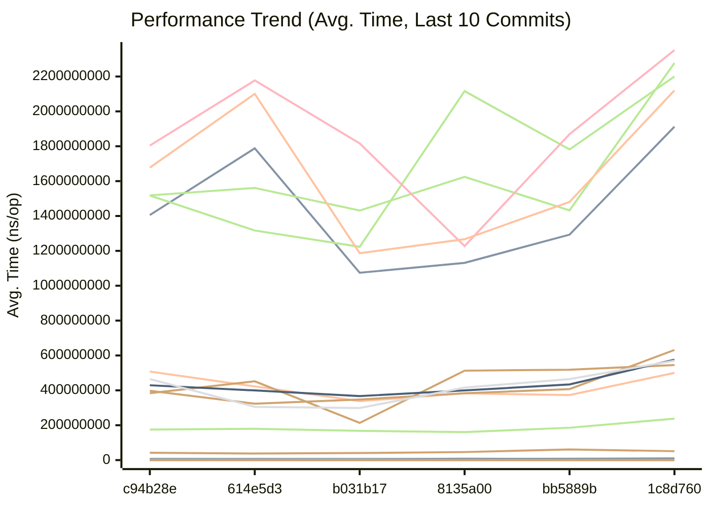
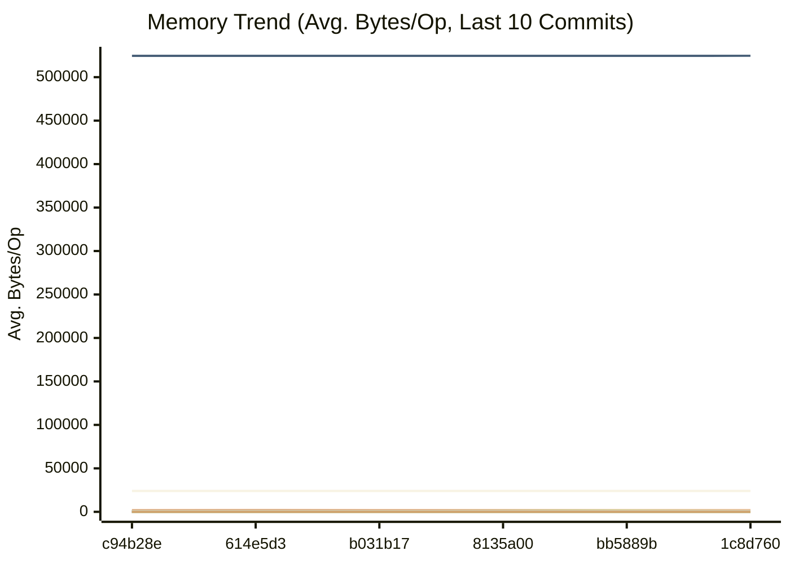
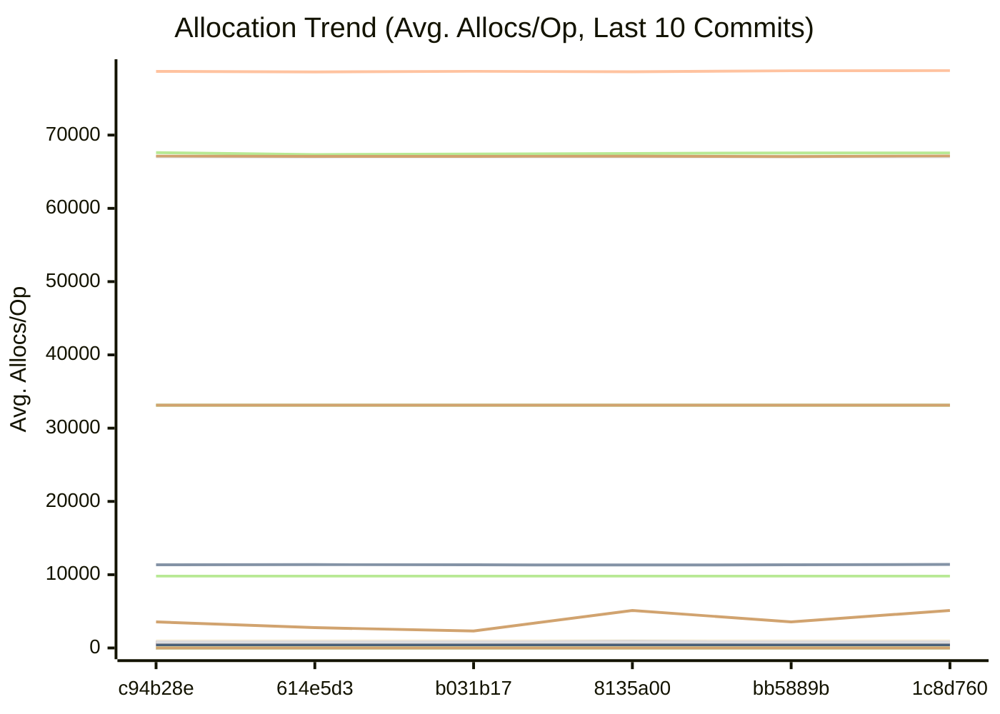

# Performance Benchmarks

This document tracks benchmark performance across commits. The section between
the `BENCHMARK_RESULTS_START/END` markers is auto-generated by the pre-commit
hook; the crypto/OPRF section below is manually maintained.

## How to Read This Document

- **Comparison with previous commit**: `benchstat` output comparing the current
  commit against the previous one. Three tables: **sec/op** (time per operation),
  **B/op** (bytes allocated), **allocs/op** (heap allocations). In each table,
  **lower is better**. `+X%` = regression, `-X%` = improvement, `~` = no
  statistically significant change. `p` is the p-value (p < 0.05 = significant).
- **Latest Benchmark Results**: Single-snapshot table of the current commit's
  averages. Lower values are better across all three columns.
- **Performance Trend plot**: X-axis = commit SHA (left = older, right = newer).
  Y-axis = avg time in ns/op. **Lower lines = faster.** Downward trends are
  improvements; upward spikes are regressions.
- **Memory Trend plot**: Same axes, but Y-axis = avg bytes allocated per op.
  **Lower lines = less memory.** Drops indicate allocation reductions.
- **Allocation Trend plot**: Same axes, but Y-axis = avg heap allocations per op.
  **Lower lines = fewer allocations.** Fewer allocs = less GC pressure.

<!-- BENCHMARK_RESULTS_START -->
## Performance

This section is automatically updated by the pre-commit hook (via .github/scripts/update_readme_with_benchmarks.sh).

### Comparison with previous commit

Each table compares the previous commit (left) to the current commit (right).
**Lower is better** in all three tables. `+X%` = regression, `-X%` = improvement,
`~` = no statistically significant change (p >= 0.05).

- **sec/op**: Time per operation (nanoseconds). Measures raw speed.
- **B/op**: Bytes allocated on the heap per operation. Measures memory usage.
- **allocs/op**: Number of heap allocations per operation. Measures GC pressure.

```
                                      │ /tmp/old_bench_filtered.txt │      /tmp/new_bench_filtered.txt       │
                                      │           sec/op            │    sec/op      vs base                 │
CrushOriginal-8                                        433.7n ± ∞ ¹    366.1n ± ∞ ¹        ~ (p=1.000 n=1) ²
Placement-8                                            4.955µ ± ∞ ¹    4.184µ ± ∞ ¹        ~ (p=1.000 n=1) ²
PlacementDomainSpread-8                                5.022µ ± ∞ ¹    4.314µ ± ∞ ¹        ~ (p=1.000 n=1) ²
CrushOptimized-8                                       333.5n ± ∞ ¹    265.1n ± ∞ ¹        ~ (p=1.000 n=1) ²
LoadGlobalConfig-8                                    10.008µ ± ∞ ¹    7.746µ ± ∞ ¹        ~ (p=1.000 n=1) ²
HashBytes/1MiB-8                                       3.710m ± ∞ ¹    3.000m ± ∞ ¹        ~ (p=1.000 n=1) ²
HashBytes/64MiB-8                                      202.0m ± ∞ ¹    200.4m ± ∞ ¹        ~ (p=1.000 n=1) ²
HashBytes/256MiB-8                                     823.3m ± ∞ ¹    726.6m ± ∞ ¹        ~ (p=1.000 n=1) ²
HashFile/1MiB-8                                        3.675m ± ∞ ¹    2.969m ± ∞ ¹        ~ (p=1.000 n=1) ²
HashFile/64MiB-8                                       239.5m ± ∞ ¹    218.3m ± ∞ ¹        ~ (p=1.000 n=1) ²
HashFile/256MiB-8                                     1000.1m ± ∞ ¹    739.7m ± ∞ ¹        ~ (p=1.000 n=1) ²
PadString-8                                            42.59n ± ∞ ¹    36.64n ± ∞ ¹        ~ (p=1.000 n=1) ²
SanitizeLog/Safe-8                                     226.1n ± ∞ ¹    208.8n ± ∞ ¹        ~ (p=1.000 n=1) ²
SanitizeLog/Unsafe-8                                   820.0n ± ∞ ¹    504.6n ± ∞ ¹        ~ (p=1.000 n=1) ²
AWSChunkedReaderSigned-8                               548.2µ ± ∞ ¹    405.2µ ± ∞ ¹        ~ (p=1.000 n=1) ²
AWSChunkedReaderUnsigned-8                             406.5µ ± ∞ ¹    398.8µ ± ∞ ¹        ~ (p=1.000 n=1) ²
ParseAWSChunkHeader-8                                  59.59n ± ∞ ¹    48.01n ± ∞ ¹        ~ (p=1.000 n=1) ²
LastModifiedHeader_AppendFormat-8                      215.9n ± ∞ ¹    278.1n ± ∞ ¹        ~ (p=1.000 n=1) ²
LastModifiedHeader_Format-8                            267.6n ± ∞ ¹    228.8n ± ∞ ¹        ~ (p=1.000 n=1) ²
EtagMatches-8                                          131.3n ± ∞ ¹    135.8n ± ∞ ¹        ~ (p=1.000 n=1) ²
EtagMatchesSplit-8                                     258.0n ± ∞ ¹    199.4n ± ∞ ¹        ~ (p=1.000 n=1) ²
ListPartsTime_AppendFormat-8                           147.1n ± ∞ ¹    111.9n ± ∞ ¹        ~ (p=1.000 n=1) ²
ListPartsTime_Format-8                                 228.4n ± ∞ ¹    131.4n ± ∞ ¹        ~ (p=1.000 n=1) ²
FormatListObjectsV2XML_AppendFormat-8                 1042.6µ ± ∞ ¹    433.9µ ± ∞ ¹        ~ (p=1.000 n=1) ²
FormatListObjectsV2XML_OldFormat-8                     418.2µ ± ∞ ¹    322.7µ ± ∞ ¹        ~ (p=1.000 n=1) ²
PheromoneSelectReplica-8                               146.8n ± ∞ ¹    100.5n ± ∞ ¹        ~ (p=1.000 n=1) ²
CheckMetricsAndSwap-8                                 11.050n ± ∞ ¹    8.165n ± ∞ ¹        ~ (p=1.000 n=1) ²
IndexSearch-8                                          2.824n ± ∞ ¹    1.433n ± ∞ ¹        ~ (p=1.000 n=1) ²
IndexDirectTracking-8                                 0.3756n ± ∞ ¹   0.3360n ± ∞ ¹        ~ (p=1.000 n=1) ²
LocalWrite/1MiB-8                                     1010.9µ ± ∞ ¹    347.3µ ± ∞ ¹        ~ (p=1.000 n=1) ²
LocalWrite/64MiB-8                                     30.35m ± ∞ ¹    28.02m ± ∞ ¹        ~ (p=1.000 n=1) ²
LocalWrite/256MiB-8                                    117.0m ± ∞ ¹    121.1m ± ∞ ¹        ~ (p=1.000 n=1) ²
ReadVerify/1MiB-8                                      3.328m ± ∞ ¹    4.498m ± ∞ ¹        ~ (p=1.000 n=1) ²
ReadVerify/64MiB-8                                     220.8m ± ∞ ¹    267.2m ± ∞ ¹        ~ (p=1.000 n=1) ²
ReadVerify/256MiB-8                                   1036.0m ± ∞ ¹    780.6m ± ∞ ¹        ~ (p=1.000 n=1) ²
TrustedRead/1MiB-8                                     4.597m ± ∞ ¹    3.107m ± ∞ ¹        ~ (p=1.000 n=1) ²
TrustedRead/64MiB-8                                    312.0m ± ∞ ¹    226.2m ± ∞ ¹        ~ (p=1.000 n=1) ²
TrustedRead/256MiB-8                                   915.7m ± ∞ ¹    873.3m ± ∞ ¹        ~ (p=1.000 n=1) ²
S3PutSpool/1MiB-8                                      5.035m ± ∞ ¹    4.582m ± ∞ ¹        ~ (p=1.000 n=1) ²
S3PutSpool/64MiB-8                                     397.5m ± ∞ ¹    406.0m ± ∞ ¹        ~ (p=1.000 n=1) ²
S3PutSpool/256MiB-8                                   1142.7m ± ∞ ¹    964.6m ± ∞ ¹        ~ (p=1.000 n=1) ²
geomean                                                111.4µ          90.19µ        -19.02%
¹ need >= 6 samples for confidence interval at level 0.95
² need >= 4 samples to detect a difference at alpha level 0.05

                                      │ /tmp/old_bench_filtered.txt │      /tmp/new_bench_filtered.txt      │
                                      │            B/op             │     B/op       vs base                │
CrushOriginal-8                                         164.0 ± ∞ ¹     164.0 ± ∞ ¹       ~ (p=1.000 n=1) ²
Placement-8                                             352.0 ± ∞ ¹     352.0 ± ∞ ¹       ~ (p=1.000 n=1) ²
PlacementDomainSpread-8                                 352.0 ± ∞ ¹     352.0 ± ∞ ¹       ~ (p=1.000 n=1) ²
CrushOptimized-8                                        0.000 ± ∞ ¹     0.000 ± ∞ ¹       ~ (p=1.000 n=1) ²
LoadGlobalConfig-8                                    1.930Ki ± ∞ ¹   1.930Ki ± ∞ ¹       ~ (p=1.000 n=1) ²
HashBytes/1MiB-8                                        64.00 ± ∞ ¹     64.00 ± ∞ ¹       ~ (p=1.000 n=1) ²
HashBytes/64MiB-8                                       64.00 ± ∞ ¹     64.00 ± ∞ ¹       ~ (p=1.000 n=1) ²
HashBytes/256MiB-8                                      64.00 ± ∞ ¹     64.00 ± ∞ ¹       ~ (p=1.000 n=1) ²
HashFile/1MiB-8                                       32.35Ki ± ∞ ¹   32.35Ki ± ∞ ¹       ~ (p=1.000 n=1) ²
HashFile/64MiB-8                                      32.35Ki ± ∞ ¹   32.35Ki ± ∞ ¹       ~ (p=1.000 n=1) ²
HashFile/256MiB-8                                     32.35Ki ± ∞ ¹   32.35Ki ± ∞ ¹       ~ (p=1.000 n=1) ²
PadString-8                                             64.00 ± ∞ ¹     64.00 ± ∞ ¹       ~ (p=1.000 n=1) ²
SanitizeLog/Safe-8                                      0.000 ± ∞ ¹     0.000 ± ∞ ¹       ~ (p=1.000 n=1) ²
SanitizeLog/Unsafe-8                                    704.0 ± ∞ ¹     704.0 ± ∞ ¹       ~ (p=1.000 n=1) ²
AWSChunkedReaderSigned-8                              10.93Ki ± ∞ ¹   10.92Ki ± ∞ ¹       ~ (p=1.000 n=1) ³
AWSChunkedReaderUnsigned-8                            76.68Ki ± ∞ ¹   76.67Ki ± ∞ ¹       ~ (p=1.000 n=1) ³
ParseAWSChunkHeader-8                                   0.000 ± ∞ ¹     0.000 ± ∞ ¹       ~ (p=1.000 n=1) ²
LastModifiedHeader_AppendFormat-8                       0.000 ± ∞ ¹     0.000 ± ∞ ¹       ~ (p=1.000 n=1) ²
LastModifiedHeader_Format-8                             32.00 ± ∞ ¹     32.00 ± ∞ ¹       ~ (p=1.000 n=1) ²
EtagMatches-8                                           0.000 ± ∞ ¹     0.000 ± ∞ ¹       ~ (p=1.000 n=1) ²
EtagMatchesSplit-8                                      80.00 ± ∞ ¹     80.00 ± ∞ ¹       ~ (p=1.000 n=1) ²
ListPartsTime_AppendFormat-8                            0.000 ± ∞ ¹     0.000 ± ∞ ¹       ~ (p=1.000 n=1) ²
ListPartsTime_Format-8                                  24.00 ± ∞ ¹     24.00 ± ∞ ¹       ~ (p=1.000 n=1) ²
FormatListObjectsV2XML_AppendFormat-8                 512.1Ki ± ∞ ¹   512.1Ki ± ∞ ¹       ~ (p=1.000 n=1) ³
FormatListObjectsV2XML_OldFormat-8                    23.44Ki ± ∞ ¹   23.44Ki ± ∞ ¹       ~ (p=1.000 n=1) ²
PheromoneSelectReplica-8                                0.000 ± ∞ ¹     0.000 ± ∞ ¹       ~ (p=1.000 n=1) ²
CheckMetricsAndSwap-8                                   0.000 ± ∞ ¹     0.000 ± ∞ ¹       ~ (p=1.000 n=1) ²
IndexSearch-8                                           0.000 ± ∞ ¹     0.000 ± ∞ ¹       ~ (p=1.000 n=1) ²
IndexDirectTracking-8                                   0.000 ± ∞ ¹     0.000 ± ∞ ¹       ~ (p=1.000 n=1) ²
LocalWrite/1MiB-8                                     65.51Ki ± ∞ ¹   65.50Ki ± ∞ ¹       ~ (p=1.000 n=1) ³
LocalWrite/64MiB-8                                    65.55Ki ± ∞ ¹   65.54Ki ± ∞ ¹       ~ (p=1.000 n=1) ³
LocalWrite/256MiB-8                                   65.80Ki ± ∞ ¹   65.74Ki ± ∞ ¹       ~ (p=1.000 n=1) ³
ReadVerify/1MiB-8                                       458.0 ± ∞ ¹     471.0 ± ∞ ¹       ~ (p=1.000 n=1) ³
ReadVerify/64MiB-8                                    2.253Ki ± ∞ ¹   2.711Ki ± ∞ ¹       ~ (p=1.000 n=1) ³
ReadVerify/256MiB-8                                   9.578Ki ± ∞ ¹   5.000Ki ± ∞ ¹       ~ (p=1.000 n=1) ³
TrustedRead/1MiB-8                                      800.0 ± ∞ ¹     822.0 ± ∞ ¹       ~ (p=1.000 n=1) ³
TrustedRead/64MiB-8                                     800.0 ± ∞ ¹     800.0 ± ∞ ¹       ~ (p=1.000 n=1) ²
TrustedRead/256MiB-8                                    800.0 ± ∞ ¹     800.0 ± ∞ ¹       ~ (p=1.000 n=1) ²
S3PutSpool/1MiB-8                                       447.0 ± ∞ ¹     447.0 ± ∞ ¹       ~ (p=1.000 n=1) ²
S3PutSpool/64MiB-8                                      448.0 ± ∞ ¹     448.0 ± ∞ ¹       ~ (p=1.000 n=1) ²
S3PutSpool/256MiB-8                                     448.0 ± ∞ ¹     448.0 ± ∞ ¹       ~ (p=1.000 n=1) ²
geomean                                                           ⁴                  -1.00%               ⁴
¹ need >= 6 samples for confidence interval at level 0.95
² all samples are equal
³ need >= 4 samples to detect a difference at alpha level 0.05
⁴ summaries must be >0 to compute geomean

                                      │ /tmp/old_bench_filtered.txt │     /tmp/new_bench_filtered.txt      │
                                      │          allocs/op          │  allocs/op    vs base                │
CrushOriginal-8                                         3.000 ± ∞ ¹    3.000 ± ∞ ¹       ~ (p=1.000 n=1) ²
Placement-8                                             6.000 ± ∞ ¹    6.000 ± ∞ ¹       ~ (p=1.000 n=1) ²
PlacementDomainSpread-8                                 6.000 ± ∞ ¹    6.000 ± ∞ ¹       ~ (p=1.000 n=1) ²
CrushOptimized-8                                        0.000 ± ∞ ¹    0.000 ± ∞ ¹       ~ (p=1.000 n=1) ²
LoadGlobalConfig-8                                      58.00 ± ∞ ¹    58.00 ± ∞ ¹       ~ (p=1.000 n=1) ²
HashBytes/1MiB-8                                        1.000 ± ∞ ¹    1.000 ± ∞ ¹       ~ (p=1.000 n=1) ²
HashBytes/64MiB-8                                       1.000 ± ∞ ¹    1.000 ± ∞ ¹       ~ (p=1.000 n=1) ²
HashBytes/256MiB-8                                      1.000 ± ∞ ¹    1.000 ± ∞ ¹       ~ (p=1.000 n=1) ²
HashFile/1MiB-8                                         6.000 ± ∞ ¹    6.000 ± ∞ ¹       ~ (p=1.000 n=1) ²
HashFile/64MiB-8                                        6.000 ± ∞ ¹    6.000 ± ∞ ¹       ~ (p=1.000 n=1) ²
HashFile/256MiB-8                                       6.000 ± ∞ ¹    6.000 ± ∞ ¹       ~ (p=1.000 n=1) ²
PadString-8                                             1.000 ± ∞ ¹    1.000 ± ∞ ¹       ~ (p=1.000 n=1) ²
SanitizeLog/Safe-8                                      0.000 ± ∞ ¹    0.000 ± ∞ ¹       ~ (p=1.000 n=1) ²
SanitizeLog/Unsafe-8                                    1.000 ± ∞ ¹    1.000 ± ∞ ¹       ~ (p=1.000 n=1) ²
AWSChunkedReaderSigned-8                                77.00 ± ∞ ¹    77.00 ± ∞ ¹       ~ (p=1.000 n=1) ²
AWSChunkedReaderUnsigned-8                              12.00 ± ∞ ¹    12.00 ± ∞ ¹       ~ (p=1.000 n=1) ²
ParseAWSChunkHeader-8                                   0.000 ± ∞ ¹    0.000 ± ∞ ¹       ~ (p=1.000 n=1) ²
LastModifiedHeader_AppendFormat-8                       0.000 ± ∞ ¹    0.000 ± ∞ ¹       ~ (p=1.000 n=1) ²
LastModifiedHeader_Format-8                             1.000 ± ∞ ¹    1.000 ± ∞ ¹       ~ (p=1.000 n=1) ²
EtagMatches-8                                           0.000 ± ∞ ¹    0.000 ± ∞ ¹       ~ (p=1.000 n=1) ²
EtagMatchesSplit-8                                      1.000 ± ∞ ¹    1.000 ± ∞ ¹       ~ (p=1.000 n=1) ²
ListPartsTime_AppendFormat-8                            0.000 ± ∞ ¹    0.000 ± ∞ ¹       ~ (p=1.000 n=1) ²
ListPartsTime_Format-8                                  1.000 ± ∞ ¹    1.000 ± ∞ ¹       ~ (p=1.000 n=1) ²
FormatListObjectsV2XML_AppendFormat-8                   16.00 ± ∞ ¹    16.00 ± ∞ ¹       ~ (p=1.000 n=1) ²
FormatListObjectsV2XML_OldFormat-8                     1.000k ± ∞ ¹   1.000k ± ∞ ¹       ~ (p=1.000 n=1) ²
PheromoneSelectReplica-8                                0.000 ± ∞ ¹    0.000 ± ∞ ¹       ~ (p=1.000 n=1) ²
CheckMetricsAndSwap-8                                   0.000 ± ∞ ¹    0.000 ± ∞ ¹       ~ (p=1.000 n=1) ²
IndexSearch-8                                           0.000 ± ∞ ¹    0.000 ± ∞ ¹       ~ (p=1.000 n=1) ²
IndexDirectTracking-8                                   0.000 ± ∞ ¹    0.000 ± ∞ ¹       ~ (p=1.000 n=1) ²
LocalWrite/1MiB-8                                       20.00 ± ∞ ¹    20.00 ± ∞ ¹       ~ (p=1.000 n=1) ²
LocalWrite/64MiB-8                                      19.00 ± ∞ ¹    19.00 ± ∞ ¹       ~ (p=1.000 n=1) ²
LocalWrite/256MiB-8                                     21.00 ± ∞ ¹    20.00 ± ∞ ¹       ~ (p=1.000 n=1) ³
ReadVerify/1MiB-8                                       6.000 ± ∞ ¹    6.000 ± ∞ ¹       ~ (p=1.000 n=1) ²
ReadVerify/64MiB-8                                      6.000 ± ∞ ¹    7.000 ± ∞ ¹       ~ (p=1.000 n=1) ³
ReadVerify/256MiB-8                                    10.000 ± ∞ ¹    8.000 ± ∞ ¹       ~ (p=1.000 n=1) ³
TrustedRead/1MiB-8                                      11.00 ± ∞ ¹    11.00 ± ∞ ¹       ~ (p=1.000 n=1) ²
TrustedRead/64MiB-8                                     11.00 ± ∞ ¹    11.00 ± ∞ ¹       ~ (p=1.000 n=1) ²
TrustedRead/256MiB-8                                    11.00 ± ∞ ¹    11.00 ± ∞ ¹       ~ (p=1.000 n=1) ²
S3PutSpool/1MiB-8                                       10.00 ± ∞ ¹    10.00 ± ∞ ¹       ~ (p=1.000 n=1) ²
S3PutSpool/64MiB-8                                      10.00 ± ∞ ¹    10.00 ± ∞ ¹       ~ (p=1.000 n=1) ²
S3PutSpool/256MiB-8                                     10.00 ± ∞ ¹    10.00 ± ∞ ¹       ~ (p=1.000 n=1) ²
geomean                                                           ⁴                 -0.29%               ⁴
¹ need >= 6 samples for confidence interval at level 0.95
² all samples are equal
³ need >= 4 samples to detect a difference at alpha level 0.05
⁴ summaries must be >0 to compute geomean

                           │ /tmp/old_bench_filtered.txt │       /tmp/new_bench_filtered.txt       │
                           │             B/s             │      B/s        vs base                 │
HashBytes/1MiB-8                           269.5Mi ± ∞ ¹    333.3Mi ± ∞ ¹        ~ (p=1.000 n=1) ²
HashBytes/64MiB-8                          316.8Mi ± ∞ ¹    319.4Mi ± ∞ ¹        ~ (p=1.000 n=1) ²
HashBytes/256MiB-8                         310.9Mi ± ∞ ¹    352.3Mi ± ∞ ¹        ~ (p=1.000 n=1) ²
HashFile/1MiB-8                            272.1Mi ± ∞ ¹    336.8Mi ± ∞ ¹        ~ (p=1.000 n=1) ²
HashFile/64MiB-8                           267.2Mi ± ∞ ¹    293.2Mi ± ∞ ¹        ~ (p=1.000 n=1) ²
HashFile/256MiB-8                          256.0Mi ± ∞ ¹    346.1Mi ± ∞ ¹        ~ (p=1.000 n=1) ²
AWSChunkedReaderSigned-8                   115.8Mi ± ∞ ¹    156.7Mi ± ∞ ¹        ~ (p=1.000 n=1) ²
AWSChunkedReaderUnsigned-8                 156.1Mi ± ∞ ¹    159.2Mi ± ∞ ¹        ~ (p=1.000 n=1) ²
LocalWrite/1MiB-8                          989.2Mi ± ∞ ¹   2879.4Mi ± ∞ ¹        ~ (p=1.000 n=1) ²
LocalWrite/64MiB-8                         2.059Gi ± ∞ ¹    2.231Gi ± ∞ ¹        ~ (p=1.000 n=1) ²
LocalWrite/256MiB-8                        2.137Gi ± ∞ ¹    2.064Gi ± ∞ ¹        ~ (p=1.000 n=1) ²
ReadVerify/1MiB-8                          300.5Mi ± ∞ ¹    222.3Mi ± ∞ ¹        ~ (p=1.000 n=1) ²
ReadVerify/64MiB-8                         289.8Mi ± ∞ ¹    239.6Mi ± ∞ ¹        ~ (p=1.000 n=1) ²
ReadVerify/256MiB-8                        247.1Mi ± ∞ ¹    327.9Mi ± ∞ ¹        ~ (p=1.000 n=1) ²
TrustedRead/1MiB-8                         217.5Mi ± ∞ ¹    321.8Mi ± ∞ ¹        ~ (p=1.000 n=1) ²
TrustedRead/64MiB-8                        205.1Mi ± ∞ ¹    283.0Mi ± ∞ ¹        ~ (p=1.000 n=1) ²
TrustedRead/256MiB-8                       279.6Mi ± ∞ ¹    293.2Mi ± ∞ ¹        ~ (p=1.000 n=1) ²
S3PutSpool/1MiB-8                          198.6Mi ± ∞ ¹    218.3Mi ± ∞ ¹        ~ (p=1.000 n=1) ²
S3PutSpool/64MiB-8                         161.0Mi ± ∞ ¹    157.6Mi ± ∞ ¹        ~ (p=1.000 n=1) ²
S3PutSpool/256MiB-8                        224.0Mi ± ∞ ¹    265.4Mi ± ∞ ¹        ~ (p=1.000 n=1) ²
geomean                                    312.4Mi          366.3Mi        +17.25%
¹ need >= 6 samples for confidence interval at level 0.95
² need >= 4 samples to detect a difference at alpha level 0.05
```

### Latest Benchmark Results

Single-snapshot of the current commit's averages. **Lower is better** across all
three columns: time (speed), bytes (memory), allocs (GC pressure).


| Benchmark | Avg. Time/Op | Avg. Bytes/Op | Avg. Allocs/Op |
|-----------|--------------|---------------|----------------|
| BenchmarkAdaptivePutBlob64KiB-8 | 17.00 ns/op | 0.00 B/op | 0.00 allocs/op |
| BenchmarkAWSChunkedReaderSigned-8 | 405170.00 ns/op | 164.28 B/op | 11180.00 allocs/op |
| BenchmarkAWSChunkedReaderUnsigned-8 | 398826.00 ns/op | 166.89 B/op | 78515.00 allocs/op |
| BenchmarkCheckMetricsAndSwap-8 | 8.16 ns/op | 0.00 B/op | 0.00 allocs/op |
| BenchmarkCrushOptimized-8 | 265.10 ns/op | 0.00 B/op | 0.00 allocs/op |
| BenchmarkCrushOriginal-8 | 366.10 ns/op | 164.00 B/op | 3.00 allocs/op |
| BenchmarkEtagMatches-8 | 135.80 ns/op | 0.00 B/op | 0.00 allocs/op |
| BenchmarkEtagMatchesSplit-8 | 199.40 ns/op | 80.00 B/op | 1.00 allocs/op |
| BenchmarkFormatListObjectsV2XML_AppendFormat-8 | 433859.00 ns/op | 524428.00 B/op | 16.00 allocs/op |
| BenchmarkFormatListObjectsV2XML_OldFormat-8 | 322740.00 ns/op | 24000.00 B/op | 1000.00 allocs/op |
| BenchmarkHashBytes/1MiB-8 | 3000269.00 ns/op | 349.49 B/op | 64.00 allocs/op |
| BenchmarkHashBytes/256MiB-8 | 726614806.00 ns/op | 369.43 B/op | 64.00 allocs/op |
| BenchmarkHashBytes/64MiB-8 | 200382060.00 ns/op | 334.90 B/op | 64.00 allocs/op |
| BenchmarkHashFile/1MiB-8 | 2969187.00 ns/op | 353.15 B/op | 33128.00 allocs/op |
| BenchmarkHashFile/256MiB-8 | 739685958.00 ns/op | 362.90 B/op | 33128.00 allocs/op |
| BenchmarkHashFile/64MiB-8 | 218262290.00 ns/op | 307.47 B/op | 33128.00 allocs/op |
| BenchmarkIndexDirectTracking-8 | 0.34 ns/op | 0.00 B/op | 0.00 allocs/op |
| BenchmarkIndexSearch-8 | 1.43 ns/op | 0.00 B/op | 0.00 allocs/op |
| BenchmarkLastModifiedHeader_AppendFormat-8 | 278.10 ns/op | 0.00 B/op | 0.00 allocs/op |
| BenchmarkLastModifiedHeader_Format-8 | 228.80 ns/op | 32.00 B/op | 1.00 allocs/op |
| BenchmarkListPartsTime_AppendFormat-8 | 111.90 ns/op | 0.00 B/op | 0.00 allocs/op |
| BenchmarkListPartsTime_Format-8 | 131.40 ns/op | 24.00 B/op | 1.00 allocs/op |
| BenchmarkLoadGlobalConfig-8 | 7746.00 ns/op | 1976.00 B/op | 58.00 allocs/op |
| BenchmarkLocalWrite/1MiB-8 | 347300.00 ns/op | 3019.22 B/op | 67076.00 allocs/op |
| BenchmarkLocalWrite/256MiB-8 | 121124511.00 ns/op | 2216.19 B/op | 67316.00 allocs/op |
| BenchmarkLocalWrite/64MiB-8 | 28019036.00 ns/op | 2395.12 B/op | 67115.00 allocs/op |
| BenchmarkPadString-8 | 36.64 ns/op | 64.00 B/op | 1.00 allocs/op |
| BenchmarkParseAWSChunkHeader-8 | 48.01 ns/op | 0.00 B/op | 0.00 allocs/op |
| BenchmarkPheromoneSelectReplica-8 | 100.50 ns/op | 0.00 B/op | 0.00 allocs/op |
| BenchmarkPlacement-8 | 4184.00 ns/op | 352.00 B/op | 6.00 allocs/op |
| BenchmarkPlacementDomainSpread-8 | 4314.00 ns/op | 352.00 B/op | 6.00 allocs/op |
| BenchmarkReadVerify/1MiB-8 | 4498182.00 ns/op | 233.11 B/op | 471.00 allocs/op |
| BenchmarkReadVerify/256MiB-8 | 780597293.00 ns/op | 343.88 B/op | 5120.00 allocs/op |
| BenchmarkReadVerify/64MiB-8 | 267156263.00 ns/op | 251.20 B/op | 2776.00 allocs/op |
| BenchmarkS3PutSpool/1MiB-8 | 4581575.00 ns/op | 228.87 B/op | 447.00 allocs/op |
| BenchmarkS3PutSpool/256MiB-8 | 964616587.00 ns/op | 278.28 B/op | 448.00 allocs/op |
| BenchmarkS3PutSpool/64MiB-8 | 405975024.00 ns/op | 165.30 B/op | 448.00 allocs/op |
| BenchmarkSanitizeLog/Safe-8 | 208.80 ns/op | 0.00 B/op | 0.00 allocs/op |
| BenchmarkSanitizeLog/Unsafe-8 | 504.60 ns/op | 704.00 B/op | 1.00 allocs/op |
| BenchmarkTrustedRead/1MiB-8 | 3107216.00 ns/op | 337.46 B/op | 822.00 allocs/op |
| BenchmarkTrustedRead/256MiB-8 | 873252194.00 ns/op | 307.40 B/op | 800.00 allocs/op |
| BenchmarkTrustedRead/64MiB-8 | 226161143.00 ns/op | 296.73 B/op | 800.00 allocs/op |
| BenchmarkVolumeGetBlob64KiB-8 | 17.00 ns/op | 0.00 B/op | 0.00 allocs/op |
| BenchmarkVolumePutBlob64KiB-8 | 17.00 ns/op | 0.00 B/op | 0.00 allocs/op |


### Performance History

**Legend**

| Color | Benchmark | Description |
|---|---|---|
| 🟢 | CheckMetricsAndSwap | Evaluation of system metrics (CPU/Mem) and mode switching logic |
| 🟤 | CrushOriginal | Original Sage Weil's CRUSH placement algorithm using reflection and float math |
| ⚪ | CrushOptimized | Performance-tuned CRUSH-lite placement algorithm using bitwise shifts and integer math (Rule 19) |
| 🔵 | IndexDirectTracking | Accessing current replication mode via direct slice index (O(1)) |
| 🔴 | IndexSearch | Searching for current replication mode in the order slice using `slices.Index` |
| 🟠 | LoadGlobalConfig | Parsing and loading the `[global]` section from the INI configuration |
| 🟣 | PadString | Padding strings with null characters to a fixed protocol length |
| 🟡 | ParseReplicationOrder | Parsing the CSV-formatted replication order string into an integer slice |

#### Time per Operation (ns/op)

X-axis: commit SHA (left = older, right = newer). Y-axis: avg time in ns/op.
**Lower lines = faster code.** Downward trends are improvements; upward spikes
are regressions to investigate.



#### Memory per Operation (B/op)

X-axis: commit SHA. Y-axis: avg bytes allocated per op.
**Lower lines = less memory.** Drops indicate allocation reductions.



#### Allocations per Operation (allocs/op)

X-axis: commit SHA. Y-axis: avg heap allocations per op.
**Lower lines = fewer allocations.** Fewer allocs = less GC pressure.


<!-- BENCHMARK_RESULTS_END -->

### E2EE + OPRF overhead

The sections above are auto-generated and cover the hot-path benchmarks. The
crypto/OPRF work is measured separately; figures below are from `go test -bench`
on the crypto module and are intentionally placed outside the auto-managed block
so they persist.

**Lower is better** across all columns. These benchmarks run on `src/crypto` only
(not tracked in the auto-generated plots above).

| Benchmark | What it measures | Avg. Time/Op | Avg. Bytes/Op | Avg. Allocs/Op |
|-----------|------------------|--------------|---------------|----------------|
| EncryptStream | AES-GCM-256 chunked encryption (64KB input) | ~63 µs | 167 KB | 14 |
| DecryptStream | AES-GCM-256 chunked decryption (64KB input) | ~54 µs | 136 KB | 13 |
| DeriveKey | HKDF-SHA256 key derivation per tenant | ~3.5 µs | 1.3 KB | 18 |
| OPRFCombineThreshold3 | Threshold-3 OPRF combine + unblind (Ristretto255) | ~530 µs | 2.3 KB | 62 |

With `encryption_enabled`, every byte passes through AES-GCM-256 streaming at
~800-1200 MB/s (chunk-bounded memory). The streaming format is **StreamVersion
v4 (issue #824)** with a self-describing chunk size: the default 4096-byte
chunk preserves prior throughput, and the chunk size can be raised/lowered via
`SetStreamChunkSize` within `[512, 4128]` for latency/memory trade-offs without
a wire change in framing beyond the 2-byte header field (v3/v2 blobs still
decode). The threshold OPRF is evaluated **once per
upload/download**, on the dedup tag only (never per chunk):
`OPRFCombineThreshold3` measures a one-time ~0.53 ms client-side combine/unblind
for threshold-3, plus one round-trip per daemon share. This is negligible against
network/disk I/O and does not affect streaming throughput. When `oprf_enabled =
false`, the OPRF path is skipped entirely and behavior is identical to the
pre-OPRF encryption path (backward compatible).
