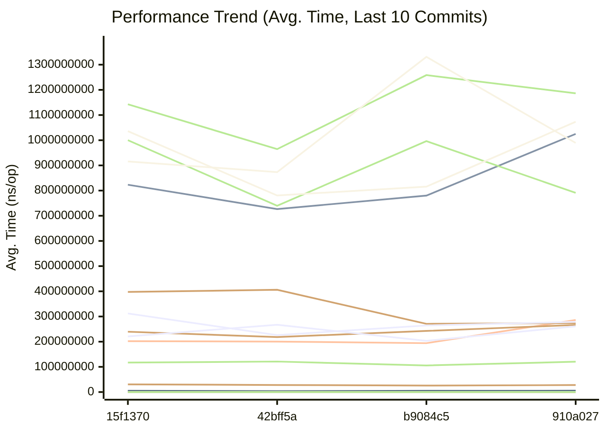
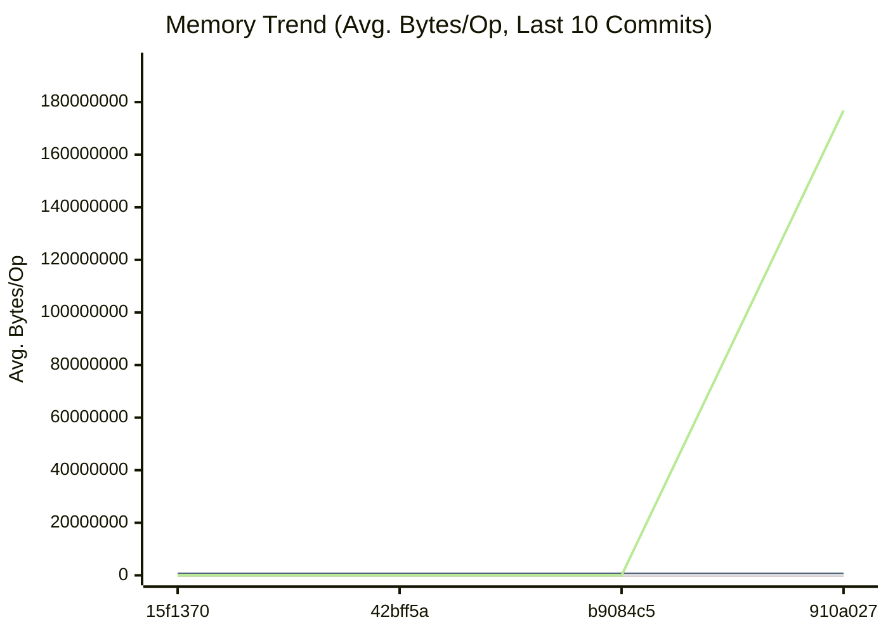
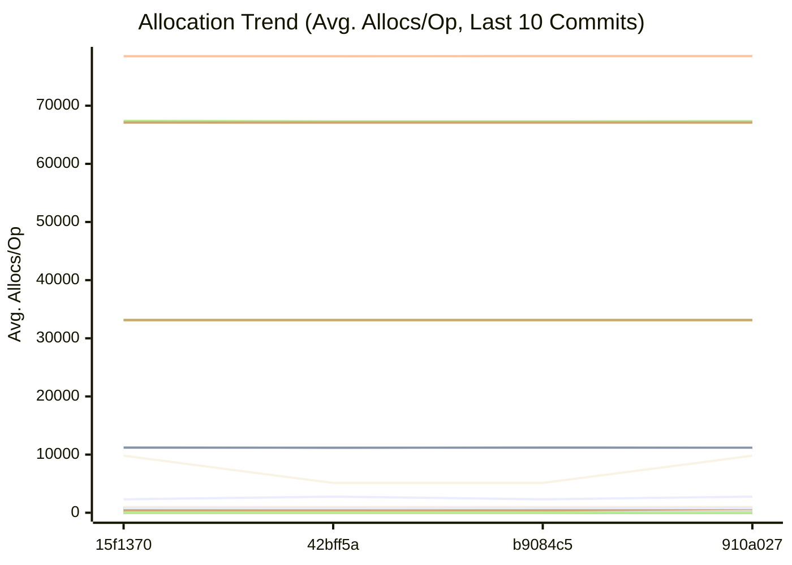

# Performance Benchmarks

This document tracks benchmark performance across commits. The section between
the `BENCHMARK_RESULTS_START/END` markers is auto-generated by the pre-commit
hook; the crypto/OPRF section below is manually maintained.

## How to Read This Document

- **Comparison with previous commit**: `benchstat` output comparing the current
  commit against the previous one. Three tables: **sec/op** (time per operation),
  **B/op** (bytes allocated), **allocs/op** (heap allocations). In each table,
  **lower is better**. `+X%` = regression, `-X%` = improvement, `~` = no
  statistically significant change. `p` is the p-value (p < 0.05 = significant).
- **Latest Benchmark Results**: Single-snapshot table of the current commit's
  averages. Lower values are better across all three columns.
- **Performance Trend plot**: X-axis = commit SHA (left = older, right = newer).
  Y-axis = avg time in ns/op. **Lower lines = faster.** Downward trends are
  improvements; upward spikes are regressions.
- **Memory Trend plot**: Same axes, but Y-axis = avg bytes allocated per op.
  **Lower lines = less memory.** Drops indicate allocation reductions.
- **Allocation Trend plot**: Same axes, but Y-axis = avg heap allocations per op.
  **Lower lines = fewer allocations.** Fewer allocs = less GC pressure.

## Feature Hot-Path Benchmarks

Measured with `go test -bench` on the packages that own the code; each number is
a snapshot, not a CI gate. Run the listed command to reproduce on your hardware.

| Benchmark | Command | Result | Notes |
|---|---|---|---|
| `BenchmarkParseChecksum` | `go test ./src/transport -bench BenchmarkParseChecksum` | ~450 ns/op, **0 B/op, 0 allocs/op** | S3 checksum-header probe after the pre-canonicalized table (#1275). The dynamic baseline (`BenchmarkParseChecksumDynamicBaseline`) is ~930 ns/op, 96 B/op, 4 allocs/op. |
| `BenchmarkEtagMatches` | `go test ./src/transport -bench BenchmarkEtagMatches` | ~127 ns/op, **0 allocs/op** | Conditional request tag scan; `strings.Split` baseline is ~257 ns/op, 80 B/op, 1 alloc. |
| `BenchmarkParseAWSChunkHeader` | `go test ./src/transport -bench BenchmarkParseAWSChunkHeader` | ~60 ns/op, **0 allocs/op** | aws-chunked framing on S3 ingest; `strings.Split` baseline allocates 32 B/op per chunk. |
| `BenchmarkRebalanceCycle` | `go test ./src/server -bench BenchmarkRebalanceCycle` | **~25 ms per pass @ 1000 blobs** | Statfs + blob walk + coldness sort + placement. Linear in blob count; a tick every 300 s is comfortable, a million-blob node pays ~25 s per pass and only above the high-water mark. |
| `BenchmarkWriteThrottled` | `go test ./src/server -bench BenchmarkWriteThrottled` | **~1.2 µs per MiB @ 10 Gbps** | The bandwidth limiter is not the bottleneck above the cap. |
| `BenchmarkTrustedRead` | `go test ./src/storage -bench BenchmarkTrustedRead` | constant **11 allocs/op** | Read-verifier seam: re-verifying a trusted blob is disk-bound, not allocation-bound. |
| `BenchmarkParseCPUStat` | `go test ./src/p2p -bench BenchmarkParseCPUStat` | ~484 ns/op, **0 B/op, 0 allocs/op** | Health monitor `/proc/stat` parsing (#1311). The `strings.Split` baseline (`BenchmarkParseCPUStatSplitBaseline`) is ~1324 ns/op, 1840 B/op, 5 allocs/op. |
| `BenchmarkParseMemPercent` | `go test ./src/p2p -bench BenchmarkParseMemPercent` | ~749 ns/op, **0 B/op, 0 allocs/op** | Health monitor `/proc/meminfo` parsing (#1311). The baseline is ~3299 ns/op, 1888 B/op, 24 allocs/op; the sampler runs every 10 s, so this is garbage removal rather than a hot-path win. |

<!-- BENCHMARK_RESULTS_START -->
## Performance

This section is automatically updated by the pre-commit hook (via .github/scripts/update_readme_with_benchmarks.sh).

### Comparison with previous commit

Each table compares the previous commit (left) to the current commit (right).
**Lower is better** in all three tables. `+X%` = regression, `-X%` = improvement,
`~` = no statistically significant change (p >= 0.05).

- **sec/op**: Time per operation (nanoseconds). Measures raw speed.
- **B/op**: Bytes allocated on the heap per operation. Measures memory usage.
- **allocs/op**: Number of heap allocations per operation. Measures GC pressure.

```
                                      │ /tmp/old_bench_filtered.txt │      /tmp/new_bench_filtered.txt       │
                                      │           sec/op            │    sec/op      vs base                 │
CrushOriginal-8                                        532.5n ± ∞ ¹    680.9n ± ∞ ¹        ~ (p=1.000 n=1) ²
Placement-8                                            6.104µ ± ∞ ¹    7.239µ ± ∞ ¹        ~ (p=1.000 n=1) ²
PlacementDomainSpread-8                                6.664µ ± ∞ ¹    7.869µ ± ∞ ¹        ~ (p=1.000 n=1) ²
CrushOptimized-8                                       420.8n ± ∞ ¹    435.4n ± ∞ ¹        ~ (p=1.000 n=1) ²
LoadGlobalConfig-8                                     12.15µ ± ∞ ¹    16.15µ ± ∞ ¹        ~ (p=1.000 n=1) ²
HashBytes/1MiB-8                                       4.101m ± ∞ ¹    4.312m ± ∞ ¹        ~ (p=1.000 n=1) ²
HashBytes/64MiB-8                                      295.3m ± ∞ ¹    339.3m ± ∞ ¹        ~ (p=1.000 n=1) ²
HashBytes/256MiB-8                                      1.164 ± ∞ ¹     1.354 ± ∞ ¹        ~ (p=1.000 n=1) ²
HashFile/1MiB-8                                        3.490m ± ∞ ¹    5.208m ± ∞ ¹        ~ (p=1.000 n=1) ²
HashFile/64MiB-8                                       300.8m ± ∞ ¹    308.8m ± ∞ ¹        ~ (p=1.000 n=1) ²
HashFile/256MiB-8                                       1.050 ± ∞ ¹     1.181 ± ∞ ¹        ~ (p=1.000 n=1) ²
PadString-8                                            56.50n ± ∞ ¹    69.66n ± ∞ ¹        ~ (p=1.000 n=1) ²
SanitizeLog/Safe-8                                     342.1n ± ∞ ¹    412.6n ± ∞ ¹        ~ (p=1.000 n=1) ²
SanitizeLog/Unsafe-8                                   888.8n ± ∞ ¹   1191.0n ± ∞ ¹        ~ (p=1.000 n=1) ²
AWSChunkedReaderSigned-8                               564.3µ ± ∞ ¹    768.9µ ± ∞ ¹        ~ (p=1.000 n=1) ²
AWSChunkedReaderUnsigned-8                             521.3µ ± ∞ ¹    685.9µ ± ∞ ¹        ~ (p=1.000 n=1) ²
ParseAWSChunkHeader-8                                  61.18n ± ∞ ¹    91.74n ± ∞ ¹        ~ (p=1.000 n=1) ²
ParseChecksum-8                                        556.8n ± ∞ ¹    644.9n ± ∞ ¹        ~ (p=1.000 n=1) ²
ParseChecksumDynamicBaseline-8                         1.167µ ± ∞ ¹    1.814µ ± ∞ ¹        ~ (p=1.000 n=1) ²
LastModifiedHeader_AppendFormat-8                      274.6n ± ∞ ¹    374.1n ± ∞ ¹        ~ (p=1.000 n=1) ²
LastModifiedHeader_Format-8                            333.9n ± ∞ ¹    472.0n ± ∞ ¹        ~ (p=1.000 n=1) ²
EtagMatches-8                                          189.5n ± ∞ ¹    201.0n ± ∞ ¹        ~ (p=1.000 n=1) ²
EtagMatchesSplit-8                                     341.6n ± ∞ ¹    413.0n ± ∞ ¹        ~ (p=1.000 n=1) ²
ListPartsTime_AppendFormat-8                           145.3n ± ∞ ¹    205.9n ± ∞ ¹        ~ (p=1.000 n=1) ²
ListPartsTime_Format-8                                 212.0n ± ∞ ¹    259.5n ± ∞ ¹        ~ (p=1.000 n=1) ²
FormatListObjectsV2XML_AppendFormat-8                  787.0µ ± ∞ ¹    865.4µ ± ∞ ¹        ~ (p=1.000 n=1) ²
FormatListObjectsV2XML_OldFormat-8                     478.6µ ± ∞ ¹    565.3µ ± ∞ ¹        ~ (p=1.000 n=1) ²
PheromoneSelectReplica-8                               143.1n ± ∞ ¹    175.1n ± ∞ ¹        ~ (p=1.000 n=1) ²
CheckMetricsAndSwap-8                                  11.42n ± ∞ ¹    12.68n ± ∞ ¹        ~ (p=1.000 n=1) ²
IndexSearch-8                                          3.734n ± ∞ ¹    3.591n ± ∞ ¹        ~ (p=1.000 n=1) ²
IndexDirectTracking-8                                 0.3510n ± ∞ ¹   0.5724n ± ∞ ¹        ~ (p=1.000 n=1) ²
PickShedTarget-8                                       1.747µ ± ∞ ¹    2.368µ ± ∞ ¹        ~ (p=1.000 n=1) ²
WriteThrottled/unlimited-8                             6.180n ± ∞ ¹    8.902n ± ∞ ¹        ~ (p=1.000 n=1) ²
WriteThrottled/throttled-10Gbps-8                      738.9µ ± ∞ ¹    739.0µ ± ∞ ¹        ~ (p=1.000 n=1) ²
LocalWrite/1MiB-8                                      599.6µ ± ∞ ¹    601.0µ ± ∞ ¹        ~ (p=1.000 n=1) ²
LocalWrite/64MiB-8                                     30.33m ± ∞ ¹    38.18m ± ∞ ¹        ~ (p=1.000 n=1) ²
LocalWrite/256MiB-8                                    118.2m ± ∞ ¹    151.7m ± ∞ ¹        ~ (p=1.000 n=1) ²
ReadVerify/1MiB-8                                      4.632m ± ∞ ¹    5.561m ± ∞ ¹        ~ (p=1.000 n=1) ²
ReadVerify/64MiB-8                                     284.8m ± ∞ ¹    277.2m ± ∞ ¹        ~ (p=1.000 n=1) ²
ReadVerify/256MiB-8                                    902.8m ± ∞ ¹   1257.2m ± ∞ ¹        ~ (p=1.000 n=1) ²
TrustedRead/1MiB-8                                     3.759m ± ∞ ¹    5.498m ± ∞ ¹        ~ (p=1.000 n=1) ²
TrustedRead/64MiB-8                                    235.1m ± ∞ ¹    330.5m ± ∞ ¹        ~ (p=1.000 n=1) ²
TrustedRead/256MiB-8                                    1.100 ± ∞ ¹     1.387 ± ∞ ¹        ~ (p=1.000 n=1) ²
S3PutSpool/1MiB-8                                      5.005m ± ∞ ¹    5.491m ± ∞ ¹        ~ (p=1.000 n=1) ²
S3PutSpool/64MiB-8                                     331.1m ± ∞ ¹    342.7m ± ∞ ¹        ~ (p=1.000 n=1) ²
S3PutSpool/256MiB-8                                     1.356 ± ∞ ¹     1.340 ± ∞ ¹        ~ (p=1.000 n=1) ²
ParseACLResource_Split-8                               14.85n ± ∞ ¹    19.56n ± ∞ ¹        ~ (p=1.000 n=1) ²
ParseACLResource_IndexByte-8                           13.52n ± ∞ ¹    17.90n ± ∞ ¹        ~ (p=1.000 n=1) ²
geomean                                                52.73µ          64.66µ        +22.62%
¹ need >= 6 samples for confidence interval at level 0.95
² need >= 4 samples to detect a difference at alpha level 0.05

                                      │ /tmp/old_bench_filtered.txt │      /tmp/new_bench_filtered.txt      │
                                      │            B/op             │     B/op       vs base                │
CrushOriginal-8                                         164.0 ± ∞ ¹     164.0 ± ∞ ¹       ~ (p=1.000 n=1) ²
Placement-8                                             352.0 ± ∞ ¹     352.0 ± ∞ ¹       ~ (p=1.000 n=1) ²
PlacementDomainSpread-8                                 352.0 ± ∞ ¹     352.0 ± ∞ ¹       ~ (p=1.000 n=1) ²
CrushOptimized-8                                        0.000 ± ∞ ¹     0.000 ± ∞ ¹       ~ (p=1.000 n=1) ²
LoadGlobalConfig-8                                    1.930Ki ± ∞ ¹   1.930Ki ± ∞ ¹       ~ (p=1.000 n=1) ²
HashBytes/1MiB-8                                        64.00 ± ∞ ¹     64.00 ± ∞ ¹       ~ (p=1.000 n=1) ²
HashBytes/64MiB-8                                       64.00 ± ∞ ¹     64.00 ± ∞ ¹       ~ (p=1.000 n=1) ²
HashBytes/256MiB-8                                      64.00 ± ∞ ¹     64.00 ± ∞ ¹       ~ (p=1.000 n=1) ²
HashFile/1MiB-8                                       32.35Ki ± ∞ ¹   32.35Ki ± ∞ ¹       ~ (p=1.000 n=1) ²
HashFile/64MiB-8                                      32.35Ki ± ∞ ¹   32.35Ki ± ∞ ¹       ~ (p=1.000 n=1) ²
HashFile/256MiB-8                                     32.35Ki ± ∞ ¹   32.35Ki ± ∞ ¹       ~ (p=1.000 n=1) ²
PadString-8                                             64.00 ± ∞ ¹     64.00 ± ∞ ¹       ~ (p=1.000 n=1) ²
SanitizeLog/Safe-8                                      0.000 ± ∞ ¹     0.000 ± ∞ ¹       ~ (p=1.000 n=1) ²
SanitizeLog/Unsafe-8                                    704.0 ± ∞ ¹     704.0 ± ∞ ¹       ~ (p=1.000 n=1) ²
AWSChunkedReaderSigned-8                              10.95Ki ± ∞ ¹   10.99Ki ± ∞ ¹       ~ (p=1.000 n=1) ³
AWSChunkedReaderUnsigned-8                            76.70Ki ± ∞ ¹   76.73Ki ± ∞ ¹       ~ (p=1.000 n=1) ³
ParseAWSChunkHeader-8                                   0.000 ± ∞ ¹     0.000 ± ∞ ¹       ~ (p=1.000 n=1) ²
ParseChecksum-8                                         0.000 ± ∞ ¹     0.000 ± ∞ ¹       ~ (p=1.000 n=1) ²
ParseChecksumDynamicBaseline-8                          96.00 ± ∞ ¹     96.00 ± ∞ ¹       ~ (p=1.000 n=1) ²
LastModifiedHeader_AppendFormat-8                       0.000 ± ∞ ¹     0.000 ± ∞ ¹       ~ (p=1.000 n=1) ²
LastModifiedHeader_Format-8                             32.00 ± ∞ ¹     32.00 ± ∞ ¹       ~ (p=1.000 n=1) ²
EtagMatches-8                                           0.000 ± ∞ ¹     0.000 ± ∞ ¹       ~ (p=1.000 n=1) ²
EtagMatchesSplit-8                                      80.00 ± ∞ ¹     80.00 ± ∞ ¹       ~ (p=1.000 n=1) ²
ListPartsTime_AppendFormat-8                            0.000 ± ∞ ¹     0.000 ± ∞ ¹       ~ (p=1.000 n=1) ²
ListPartsTime_Format-8                                  24.00 ± ∞ ¹     24.00 ± ∞ ¹       ~ (p=1.000 n=1) ²
FormatListObjectsV2XML_AppendFormat-8                 512.2Ki ± ∞ ¹   512.2Ki ± ∞ ¹       ~ (p=1.000 n=1) ³
FormatListObjectsV2XML_OldFormat-8                    23.44Ki ± ∞ ¹   23.44Ki ± ∞ ¹       ~ (p=1.000 n=1) ²
PheromoneSelectReplica-8                                0.000 ± ∞ ¹     0.000 ± ∞ ¹       ~ (p=1.000 n=1) ²
CheckMetricsAndSwap-8                                   0.000 ± ∞ ¹     0.000 ± ∞ ¹       ~ (p=1.000 n=1) ²
IndexSearch-8                                           0.000 ± ∞ ¹     0.000 ± ∞ ¹       ~ (p=1.000 n=1) ²
IndexDirectTracking-8                                   0.000 ± ∞ ¹     0.000 ± ∞ ¹       ~ (p=1.000 n=1) ²
PickShedTarget-8                                        176.0 ± ∞ ¹     176.0 ± ∞ ¹       ~ (p=1.000 n=1) ²
WriteThrottled/unlimited-8                              0.000 ± ∞ ¹     0.000 ± ∞ ¹       ~ (p=1.000 n=1) ²
WriteThrottled/throttled-10Gbps-8                       311.0 ± ∞ ¹     234.0 ± ∞ ¹       ~ (p=1.000 n=1) ³
LocalWrite/1MiB-8                                     65.51Ki ± ∞ ¹   65.51Ki ± ∞ ¹       ~ (p=1.000 n=1) ³
LocalWrite/64MiB-8                                    65.55Ki ± ∞ ¹   65.56Ki ± ∞ ¹       ~ (p=1.000 n=1) ³
LocalWrite/256MiB-8                                   65.79Ki ± ∞ ¹   65.86Ki ± ∞ ¹       ~ (p=1.000 n=1) ³
ReadVerify/1MiB-8                                       463.0 ± ∞ ¹     474.0 ± ∞ ¹       ~ (p=1.000 n=1) ³
ReadVerify/64MiB-8                                    2.711Ki ± ∞ ¹   2.711Ki ± ∞ ¹       ~ (p=1.000 n=1) ²
ReadVerify/256MiB-8                                   5.000Ki ± ∞ ¹   9.578Ki ± ∞ ¹       ~ (p=1.000 n=1) ³
TrustedRead/1MiB-8                                      800.0 ± ∞ ¹     840.0 ± ∞ ¹       ~ (p=1.000 n=1) ³
TrustedRead/64MiB-8                                     800.0 ± ∞ ¹     800.0 ± ∞ ¹       ~ (p=1.000 n=1) ²
TrustedRead/256MiB-8                                    800.0 ± ∞ ¹     800.0 ± ∞ ¹       ~ (p=1.000 n=1) ²
S3PutSpool/1MiB-8                                       447.0 ± ∞ ¹     448.0 ± ∞ ¹       ~ (p=1.000 n=1) ³
S3PutSpool/64MiB-8                                      448.0 ± ∞ ¹     448.0 ± ∞ ¹       ~ (p=1.000 n=1) ²
S3PutSpool/256MiB-8                                     448.0 ± ∞ ¹     448.0 ± ∞ ¹       ~ (p=1.000 n=1) ²
ParseACLResource_Split-8                                0.000 ± ∞ ¹     0.000 ± ∞ ¹       ~ (p=1.000 n=1) ²
ParseACLResource_IndexByte-8                            0.000 ± ∞ ¹     0.000 ± ∞ ¹       ~ (p=1.000 n=1) ²
geomean                                                           ⁴                  +0.93%               ⁴
¹ need >= 6 samples for confidence interval at level 0.95
² all samples are equal
³ need >= 4 samples to detect a difference at alpha level 0.05
⁴ summaries must be >0 to compute geomean

                                      │ /tmp/old_bench_filtered.txt │     /tmp/new_bench_filtered.txt      │
                                      │          allocs/op          │  allocs/op    vs base                │
CrushOriginal-8                                         3.000 ± ∞ ¹    3.000 ± ∞ ¹       ~ (p=1.000 n=1) ²
Placement-8                                             6.000 ± ∞ ¹    6.000 ± ∞ ¹       ~ (p=1.000 n=1) ²
PlacementDomainSpread-8                                 6.000 ± ∞ ¹    6.000 ± ∞ ¹       ~ (p=1.000 n=1) ²
CrushOptimized-8                                        0.000 ± ∞ ¹    0.000 ± ∞ ¹       ~ (p=1.000 n=1) ²
LoadGlobalConfig-8                                      58.00 ± ∞ ¹    58.00 ± ∞ ¹       ~ (p=1.000 n=1) ²
HashBytes/1MiB-8                                        1.000 ± ∞ ¹    1.000 ± ∞ ¹       ~ (p=1.000 n=1) ²
HashBytes/64MiB-8                                       1.000 ± ∞ ¹    1.000 ± ∞ ¹       ~ (p=1.000 n=1) ²
HashBytes/256MiB-8                                      1.000 ± ∞ ¹    1.000 ± ∞ ¹       ~ (p=1.000 n=1) ²
HashFile/1MiB-8                                         6.000 ± ∞ ¹    6.000 ± ∞ ¹       ~ (p=1.000 n=1) ²
HashFile/64MiB-8                                        6.000 ± ∞ ¹    6.000 ± ∞ ¹       ~ (p=1.000 n=1) ²
HashFile/256MiB-8                                       6.000 ± ∞ ¹    6.000 ± ∞ ¹       ~ (p=1.000 n=1) ²
PadString-8                                             1.000 ± ∞ ¹    1.000 ± ∞ ¹       ~ (p=1.000 n=1) ²
SanitizeLog/Safe-8                                      0.000 ± ∞ ¹    0.000 ± ∞ ¹       ~ (p=1.000 n=1) ²
SanitizeLog/Unsafe-8                                    1.000 ± ∞ ¹    1.000 ± ∞ ¹       ~ (p=1.000 n=1) ²
AWSChunkedReaderSigned-8                                77.00 ± ∞ ¹    77.00 ± ∞ ¹       ~ (p=1.000 n=1) ²
AWSChunkedReaderUnsigned-8                              12.00 ± ∞ ¹    12.00 ± ∞ ¹       ~ (p=1.000 n=1) ²
ParseAWSChunkHeader-8                                   0.000 ± ∞ ¹    0.000 ± ∞ ¹       ~ (p=1.000 n=1) ²
ParseChecksum-8                                         0.000 ± ∞ ¹    0.000 ± ∞ ¹       ~ (p=1.000 n=1) ²
ParseChecksumDynamicBaseline-8                          4.000 ± ∞ ¹    4.000 ± ∞ ¹       ~ (p=1.000 n=1) ²
LastModifiedHeader_AppendFormat-8                       0.000 ± ∞ ¹    0.000 ± ∞ ¹       ~ (p=1.000 n=1) ²
LastModifiedHeader_Format-8                             1.000 ± ∞ ¹    1.000 ± ∞ ¹       ~ (p=1.000 n=1) ²
EtagMatches-8                                           0.000 ± ∞ ¹    0.000 ± ∞ ¹       ~ (p=1.000 n=1) ²
EtagMatchesSplit-8                                      1.000 ± ∞ ¹    1.000 ± ∞ ¹       ~ (p=1.000 n=1) ²
ListPartsTime_AppendFormat-8                            0.000 ± ∞ ¹    0.000 ± ∞ ¹       ~ (p=1.000 n=1) ²
ListPartsTime_Format-8                                  1.000 ± ∞ ¹    1.000 ± ∞ ¹       ~ (p=1.000 n=1) ²
FormatListObjectsV2XML_AppendFormat-8                   16.00 ± ∞ ¹    16.00 ± ∞ ¹       ~ (p=1.000 n=1) ²
FormatListObjectsV2XML_OldFormat-8                     1.000k ± ∞ ¹   1.000k ± ∞ ¹       ~ (p=1.000 n=1) ²
PheromoneSelectReplica-8                                0.000 ± ∞ ¹    0.000 ± ∞ ¹       ~ (p=1.000 n=1) ²
CheckMetricsAndSwap-8                                   0.000 ± ∞ ¹    0.000 ± ∞ ¹       ~ (p=1.000 n=1) ²
IndexSearch-8                                           0.000 ± ∞ ¹    0.000 ± ∞ ¹       ~ (p=1.000 n=1) ²
IndexDirectTracking-8                                   0.000 ± ∞ ¹    0.000 ± ∞ ¹       ~ (p=1.000 n=1) ²
PickShedTarget-8                                        6.000 ± ∞ ¹    6.000 ± ∞ ¹       ~ (p=1.000 n=1) ²
WriteThrottled/unlimited-8                              0.000 ± ∞ ¹    0.000 ± ∞ ¹       ~ (p=1.000 n=1) ²
WriteThrottled/throttled-10Gbps-8                       3.000 ± ∞ ¹    2.000 ± ∞ ¹       ~ (p=1.000 n=1) ³
LocalWrite/1MiB-8                                       20.00 ± ∞ ¹    20.00 ± ∞ ¹       ~ (p=1.000 n=1) ²
LocalWrite/64MiB-8                                      19.00 ± ∞ ¹    19.00 ± ∞ ¹       ~ (p=1.000 n=1) ²
LocalWrite/256MiB-8                                     21.00 ± ∞ ¹    21.00 ± ∞ ¹       ~ (p=1.000 n=1) ²
ReadVerify/1MiB-8                                       6.000 ± ∞ ¹    6.000 ± ∞ ¹       ~ (p=1.000 n=1) ²
ReadVerify/64MiB-8                                      7.000 ± ∞ ¹    7.000 ± ∞ ¹       ~ (p=1.000 n=1) ²
ReadVerify/256MiB-8                                     8.000 ± ∞ ¹   10.000 ± ∞ ¹       ~ (p=1.000 n=1) ³
TrustedRead/1MiB-8                                      11.00 ± ∞ ¹    11.00 ± ∞ ¹       ~ (p=1.000 n=1) ²
TrustedRead/64MiB-8                                     11.00 ± ∞ ¹    11.00 ± ∞ ¹       ~ (p=1.000 n=1) ²
TrustedRead/256MiB-8                                    11.00 ± ∞ ¹    11.00 ± ∞ ¹       ~ (p=1.000 n=1) ²
S3PutSpool/1MiB-8                                       10.00 ± ∞ ¹    10.00 ± ∞ ¹       ~ (p=1.000 n=1) ²
S3PutSpool/64MiB-8                                      10.00 ± ∞ ¹    10.00 ± ∞ ¹       ~ (p=1.000 n=1) ²
S3PutSpool/256MiB-8                                     10.00 ± ∞ ¹    10.00 ± ∞ ¹       ~ (p=1.000 n=1) ²
ParseACLResource_Split-8                                0.000 ± ∞ ¹    0.000 ± ∞ ¹       ~ (p=1.000 n=1) ²
ParseACLResource_IndexByte-8                            0.000 ± ∞ ¹    0.000 ± ∞ ¹       ~ (p=1.000 n=1) ²
geomean                                                           ⁴                 -0.38%               ⁴
¹ need >= 6 samples for confidence interval at level 0.95
² all samples are equal
³ need >= 4 samples to detect a difference at alpha level 0.05
⁴ summaries must be >0 to compute geomean

                                  │ /tmp/old_bench_filtered.txt │      /tmp/new_bench_filtered.txt       │
                                  │             B/s             │      B/s       vs base                 │
HashBytes/1MiB-8                                  243.8Mi ± ∞ ¹   231.9Mi ± ∞ ¹        ~ (p=1.000 n=1) ²
HashBytes/64MiB-8                                 216.7Mi ± ∞ ¹   188.6Mi ± ∞ ¹        ~ (p=1.000 n=1) ²
HashBytes/256MiB-8                                219.8Mi ± ∞ ¹   189.1Mi ± ∞ ¹        ~ (p=1.000 n=1) ²
HashFile/1MiB-8                                   286.5Mi ± ∞ ¹   192.0Mi ± ∞ ¹        ~ (p=1.000 n=1) ²
HashFile/64MiB-8                                  212.8Mi ± ∞ ¹   207.3Mi ± ∞ ¹        ~ (p=1.000 n=1) ²
HashFile/256MiB-8                                 243.8Mi ± ∞ ¹   216.8Mi ± ∞ ¹        ~ (p=1.000 n=1) ²
AWSChunkedReaderSigned-8                         112.49Mi ± ∞ ¹   82.56Mi ± ∞ ¹        ~ (p=1.000 n=1) ²
AWSChunkedReaderUnsigned-8                       121.77Mi ± ∞ ¹   92.55Mi ± ∞ ¹        ~ (p=1.000 n=1) ²
WriteThrottled/unlimited-8                        154.3Ti ± ∞ ¹   107.1Ti ± ∞ ¹        ~ (p=1.000 n=1) ²
WriteThrottled/throttled-10Gbps-8                 1.322Gi ± ∞ ¹   1.322Gi ± ∞ ¹        ~ (p=1.000 n=1) ²
LocalWrite/1MiB-8                                 1.629Gi ± ∞ ¹   1.625Gi ± ∞ ¹        ~ (p=1.000 n=1) ²
LocalWrite/64MiB-8                                2.061Gi ± ∞ ¹   1.637Gi ± ∞ ¹        ~ (p=1.000 n=1) ²
LocalWrite/256MiB-8                               2.115Gi ± ∞ ¹   1.648Gi ± ∞ ¹        ~ (p=1.000 n=1) ²
ReadVerify/1MiB-8                                 215.9Mi ± ∞ ¹   179.8Mi ± ∞ ¹        ~ (p=1.000 n=1) ²
ReadVerify/64MiB-8                                224.7Mi ± ∞ ¹   230.9Mi ± ∞ ¹        ~ (p=1.000 n=1) ²
ReadVerify/256MiB-8                               283.5Mi ± ∞ ¹   203.6Mi ± ∞ ¹        ~ (p=1.000 n=1) ²
TrustedRead/1MiB-8                                266.1Mi ± ∞ ¹   181.9Mi ± ∞ ¹        ~ (p=1.000 n=1) ²
TrustedRead/64MiB-8                               272.2Mi ± ∞ ¹   193.6Mi ± ∞ ¹        ~ (p=1.000 n=1) ²
TrustedRead/256MiB-8                              232.8Mi ± ∞ ¹   184.5Mi ± ∞ ¹        ~ (p=1.000 n=1) ²
S3PutSpool/1MiB-8                                 199.8Mi ± ∞ ¹   182.1Mi ± ∞ ¹        ~ (p=1.000 n=1) ²
S3PutSpool/64MiB-8                                193.3Mi ± ∞ ¹   186.8Mi ± ∞ ¹        ~ (p=1.000 n=1) ²
S3PutSpool/256MiB-8                               188.8Mi ± ∞ ¹   191.0Mi ± ∞ ¹        ~ (p=1.000 n=1) ²
geomean                                           581.8Mi         487.9Mi        -16.13%
¹ need >= 6 samples for confidence interval at level 0.95
² need >= 4 samples to detect a difference at alpha level 0.05
```

### Latest Benchmark Results

Single-snapshot of the current commit's averages. **Lower is better** across all
three columns: time (speed), bytes (memory), allocs (GC pressure).


| Benchmark | Avg. Time/Op | Avg. Bytes/Op | Avg. Allocs/Op |
|-----------|--------------|---------------|----------------|
| BenchmarkAdaptivePutBlob64KiB-8 | 15.00 ns/op | 0.00 B/op | 0.00 allocs/op |
| BenchmarkAWSChunkedReaderSigned-8 | 768872.00 ns/op | 86.57 B/op | 11254.00 allocs/op |
| BenchmarkAWSChunkedReaderUnsigned-8 | 685851.00 ns/op | 97.05 B/op | 78571.00 allocs/op |
| BenchmarkCheckMetricsAndSwap-8 | 12.68 ns/op | 0.00 B/op | 0.00 allocs/op |
| BenchmarkCrushOptimized-8 | 435.40 ns/op | 0.00 B/op | 0.00 allocs/op |
| BenchmarkCrushOriginal-8 | 680.90 ns/op | 164.00 B/op | 3.00 allocs/op |
| BenchmarkEtagMatches-8 | 201.00 ns/op | 0.00 B/op | 0.00 allocs/op |
| BenchmarkEtagMatchesSplit-8 | 413.00 ns/op | 80.00 B/op | 1.00 allocs/op |
| BenchmarkFormatListObjectsV2XML_AppendFormat-8 | 865431.00 ns/op | 524456.00 B/op | 16.00 allocs/op |
| BenchmarkFormatListObjectsV2XML_OldFormat-8 | 565349.00 ns/op | 24000.00 B/op | 1000.00 allocs/op |
| BenchmarkHashBytes/1MiB-8 | 4311907.00 ns/op | 243.18 B/op | 64.00 allocs/op |
| BenchmarkHashBytes/256MiB-8 | 1353975326.00 ns/op | 198.26 B/op | 64.00 allocs/op |
| BenchmarkHashBytes/64MiB-8 | 339290340.00 ns/op | 197.79 B/op | 64.00 allocs/op |
| BenchmarkHashFile/1MiB-8 | 5208142.00 ns/op | 201.33 B/op | 33128.00 allocs/op |
| BenchmarkHashFile/256MiB-8 | 1180867467.00 ns/op | 227.32 B/op | 33128.00 allocs/op |
| BenchmarkHashFile/64MiB-8 | 308784346.00 ns/op | 217.33 B/op | 33128.00 allocs/op |
| BenchmarkIndexDirectTracking-8 | 0.57 ns/op | 0.00 B/op | 0.00 allocs/op |
| BenchmarkIndexSearch-8 | 3.59 ns/op | 0.00 B/op | 0.00 allocs/op |
| BenchmarkLastModifiedHeader_AppendFormat-8 | 374.10 ns/op | 0.00 B/op | 0.00 allocs/op |
| BenchmarkLastModifiedHeader_Format-8 | 472.00 ns/op | 32.00 B/op | 1.00 allocs/op |
| BenchmarkListPartsTime_AppendFormat-8 | 205.90 ns/op | 0.00 B/op | 0.00 allocs/op |
| BenchmarkListPartsTime_Format-8 | 259.50 ns/op | 24.00 B/op | 1.00 allocs/op |
| BenchmarkLoadGlobalConfig-8 | 16149.00 ns/op | 1976.00 B/op | 58.00 allocs/op |
| BenchmarkLocalWrite/1MiB-8 | 601031.00 ns/op | 1744.63 B/op | 67084.00 allocs/op |
| BenchmarkLocalWrite/256MiB-8 | 151738005.00 ns/op | 1769.07 B/op | 67445.00 allocs/op |
| BenchmarkLocalWrite/64MiB-8 | 38178447.00 ns/op | 1757.77 B/op | 67130.00 allocs/op |
| BenchmarkPadString-8 | 69.66 ns/op | 64.00 B/op | 1.00 allocs/op |
| BenchmarkParseACLResource_IndexByte-8 | 17.90 ns/op | 0.00 B/op | 0.00 allocs/op |
| BenchmarkParseACLResource_Split-8 | 19.56 ns/op | 0.00 B/op | 0.00 allocs/op |
| BenchmarkParseAWSChunkHeader-8 | 91.74 ns/op | 0.00 B/op | 0.00 allocs/op |
| BenchmarkParseChecksum-8 | 644.90 ns/op | 0.00 B/op | 0.00 allocs/op |
| BenchmarkParseChecksumDynamicBaseline-8 | 1814.00 ns/op | 96.00 B/op | 4.00 allocs/op |
| BenchmarkPheromoneSelectReplica-8 | 175.10 ns/op | 0.00 B/op | 0.00 allocs/op |
| BenchmarkPickShedTarget-8 | 2368.00 ns/op | 176.00 B/op | 6.00 allocs/op |
| BenchmarkPlacement-8 | 7239.00 ns/op | 352.00 B/op | 6.00 allocs/op |
| BenchmarkPlacementDomainSpread-8 | 7869.00 ns/op | 352.00 B/op | 6.00 allocs/op |
| BenchmarkReadVerify/1MiB-8 | 5561121.00 ns/op | 188.55 B/op | 474.00 allocs/op |
| BenchmarkReadVerify/256MiB-8 | 1257211994.00 ns/op | 213.52 B/op | 9808.00 allocs/op |
| BenchmarkReadVerify/64MiB-8 | 277161493.00 ns/op | 242.13 B/op | 2776.00 allocs/op |
| BenchmarkRebalanceCycle/blobs=1000-8 | 15.00 ns/op | 0.00 B/op | 0.00 allocs/op |
| BenchmarkRebalanceCycle/blobs=100-8 | 15.00 ns/op | 0.00 B/op | 0.00 allocs/op |
| BenchmarkS3PutSpool/1MiB-8 | 5490687.00 ns/op | 190.97 B/op | 448.00 allocs/op |
| BenchmarkS3PutSpool/256MiB-8 | 1340049780.00 ns/op | 200.32 B/op | 448.00 allocs/op |
| BenchmarkS3PutSpool/64MiB-8 | 342650775.00 ns/op | 195.85 B/op | 448.00 allocs/op |
| BenchmarkSanitizeLog/Safe-8 | 412.60 ns/op | 0.00 B/op | 0.00 allocs/op |
| BenchmarkSanitizeLog/Unsafe-8 | 1191.00 ns/op | 704.00 B/op | 1.00 allocs/op |
| BenchmarkTrustedRead/1MiB-8 | 5498314.00 ns/op | 190.71 B/op | 840.00 allocs/op |
| BenchmarkTrustedRead/256MiB-8 | 1387232139.00 ns/op | 193.50 B/op | 800.00 allocs/op |
| BenchmarkTrustedRead/64MiB-8 | 330524006.00 ns/op | 203.04 B/op | 800.00 allocs/op |
| BenchmarkVolumeGetBlob64KiB-8 | 15.00 ns/op | 0.00 B/op | 0.00 allocs/op |
| BenchmarkVolumePutBlob64KiB-8 | 15.00 ns/op | 0.00 B/op | 0.00 allocs/op |
| BenchmarkWriteThrottled/throttled-10Gbps-8 | 738954.00 ns/op | 1419.00 B/op | 234.00 allocs/op |
| BenchmarkWriteThrottled/unlimited-8 | 8.90 ns/op | 117793000.00 B/op | 0.00 allocs/op |


### Performance History

**Legend**

| Color | Benchmark | Description |
|---|---|---|
| 🟢 | CheckMetricsAndSwap | Evaluation of system metrics (CPU/Mem) and mode switching logic |
| 🟤 | CrushOriginal | Original Sage Weil's CRUSH placement algorithm using reflection and float math |
| ⚪ | CrushOptimized | Performance-tuned CRUSH-lite placement algorithm using bitwise shifts and integer math (Rule 19) |
| 🔵 | IndexDirectTracking | Accessing current replication mode via direct slice index (O(1)) |
| 🔴 | IndexSearch | Searching for current replication mode in the order slice using `slices.Index` |
| 🟠 | LoadGlobalConfig | Parsing and loading the `[global]` section from the INI configuration |
| 🟣 | PadString | Padding strings with null characters to a fixed protocol length |
| 🟡 | ParseReplicationOrder | Parsing the CSV-formatted replication order string into an integer slice |

#### Time per Operation (ns/op)

X-axis: commit SHA (left = older, right = newer). Y-axis: avg time in ns/op.
**Lower lines = faster code.** Downward trends are improvements; upward spikes
are regressions to investigate.



#### Memory per Operation (B/op)

X-axis: commit SHA. Y-axis: avg bytes allocated per op.
**Lower lines = less memory.** Drops indicate allocation reductions.



#### Allocations per Operation (allocs/op)

X-axis: commit SHA. Y-axis: avg heap allocations per op.
**Lower lines = fewer allocations.** Fewer allocs = less GC pressure.


<!-- BENCHMARK_RESULTS_END -->

### E2EE + OPRF overhead

The sections above are auto-generated and cover the hot-path benchmarks. The
crypto/OPRF work is measured separately; figures below are from `go test -bench`
on the crypto module and are intentionally placed outside the auto-managed block
so they persist.

**Lower is better** across all columns. These benchmarks run on `src/crypto` only
(not tracked in the auto-generated plots above).

| Benchmark | What it measures | Avg. Time/Op | Avg. Bytes/Op | Avg. Allocs/Op |
|-----------|------------------|--------------|---------------|----------------|
| EncryptStream | AES-GCM-256 chunked encryption (64KB input) | ~63 µs | 167 KB | 14 |
| DecryptStream | AES-GCM-256 chunked decryption (64KB input) | ~54 µs | 136 KB | 13 |
| DeriveKey | HKDF-SHA256 key derivation per tenant | ~3.5 µs | 1.3 KB | 18 |
| OPRFCombineThreshold3 | Threshold-3 OPRF combine + unblind (Ristretto255) | ~530 µs | 2.3 KB | 62 |

With `encryption_enabled`, every byte passes through AES-GCM-256 streaming at
~800-1200 MB/s (chunk-bounded memory). The streaming format is **StreamVersion
v4 (issue #824)** with a self-describing chunk size: the default 4096-byte
chunk preserves prior throughput, and the chunk size can be raised/lowered via
`SetStreamChunkSize` within `[512, 4128]` for latency/memory trade-offs without
a wire change in framing beyond the 2-byte header field (v3/v2 blobs still
decode). The threshold OPRF is evaluated **once per
upload/download**, on the dedup tag only (never per chunk):
`OPRFCombineThreshold3` measures a one-time ~0.53 ms client-side combine/unblind
for threshold-3, plus one round-trip per daemon share. This is negligible against
network/disk I/O and does not affect streaming throughput. When `oprf_enabled =
false`, the OPRF path is skipped entirely and behavior is identical to the
pre-OPRF encryption path (backward compatible).
